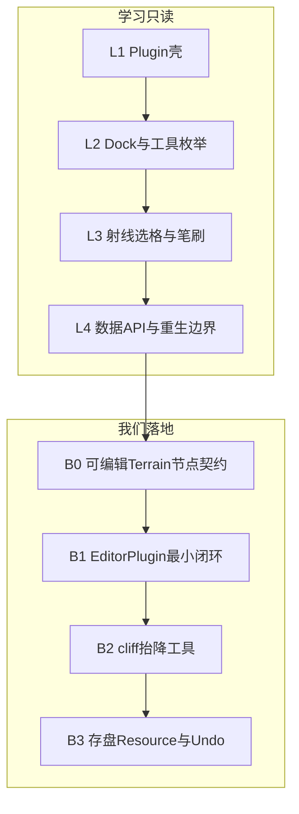

# 方案：学习 godot-rts-terrain 的「地形编辑器工具链」

**范围（只学这些）**：Godot `EditorPlugin` 怎么刷格子、Dock / 笔刷 / 工具枚举、编辑数据 API、改完重生 mesh。  
**明确不学、不抄**：其 RTS 玩法、A* / NavigationNode、金币建筑、材质画法、`.glb` 美术风格、从 mesh 灌 navmesh、整体项目结构。

对照仓（只读）：[`tools/refs/godot-rts-terrain`](../tools/refs/godot-rts-terrain)  
上游：[shmolyneaux/godot-rts-terrain](https://github.com/shmolyneaux/godot-rts-terrain)  
产品目标里「编辑器」一层：[GOALS.md](GOALS.md) §3  
与渲染线关系：本方案服务 **编辑器里程碑**，可与 [ROADMAP_P0_P5.md](ROADMAP_P0_P5.md) **并行**；不替代 P0–P2。



---

## 1. 要学的工具链骨架（他们怎么拆）

只盯这四块文件（其余当噪音）：

| 文件 | 学什么 |
|------|--------|
| `addons/rts_terrain/plugin.cfg` + `plugin.gd` | `EditorPlugin`：`_handles` / `_edit` / `_make_visible`、右侧 Dock、`_forward_3d_gui_input`、物理射线选格 |
| `TerrainEditorDock.tscn` + `.gd` | 工具 UI：`tool_changed` 信号、cliff 档 / 旋转 / 模型类型按钮如何改 `data_value` |
| `Brush.tscn` | 选中格的 3D 高亮，挂在正在编辑的地形节点下 |
| `RtsTerrain.gd` 里 **API 表面** | `get/set_cliff`、`get/set_height`、`global_to_tile` / `tile_to_global`、改数据后 `_regenerate_mesh()` |

**刻意跳过的同文件内容**：`_create_tri_face` / ramp 几何细节、`_generate_pathfinding_nodes`、`NodeNavigationServer3D`、整段「如何画漂亮 cliff」。重生函数只学 **调用边界**（谁触发、清哪些 child），不学他们的三角剖分。

数据层他们内嵌了 `TerrainData`（作者 TODO：应做成 Resource）。我们学的是 **「格数据 + 角点高度 + 改完重生」契约**，落地时用 **我们自己的 Resource**（可对齐 W3E corner 语义，或自有暗黑地图格式），**不要** fork 他们的 `PackedInt32` bit 布局当永久格式。

---

## 2. 学习步骤（只读，建议 2～3 次打开对照仓）

### L1 — Plugin 壳（半天）

在对照仓启用 **RTS Terrain** 插件，打开带 `RtsTerrain` 的场景。

对照阅读并自己笔记（勿改对照仓）：

1. `_handles(object)` 为何只认地形节点  
2. `_make_visible(true/false)` 如何挂/拆 Dock 与 Brush  
3. `CONTAINER_SPATIAL_EDITOR_SIDE_RIGHT` 的用法  

**产出**：一页笔记「选中节点 → 出 Dock；取消选中 → 拆控件」。

### L2 — Dock 与工具枚举（半天）

读 `TerrainEditorDock.gd` + `plugin.gd` 里 `TerrainTool` enum。

弄清：

- 哪些按钮只改 **工具种类**  
- 哪些按钮改 **payload**（cliff 值 / 旋转 / 模型种类）  
- `tool_changed` 如何传到 plugin 的 `active_tool`  

**产出**：一张表「工具 → 点击左键时调用的地形 API」（仍只写他们的 API 名，便于下一节映射到我们）。

### L3 — 射线选格与笔刷（半天）

读 `_forward_3d_gui_input` + `_physics_process` 里射线逻辑：

- `project_ray_origin/normal`  
- `PhysicsRayQueryParameters3D` 打到地形碰撞  
- `global_to_tile` → 移动 `Brush`  
- 按住左键连续刷 vs 单击  

**产出**：时序图（鼠标移动 / 按下 / 刷一格）。注意他们代码偏 4.0 early，记「迁到 4.7 时要核对的 API」，不要原样粘贴当最终实现。

### L4 — 数据 API 与重生边界（半天）

只读 `RtsTerrain` 的：

- `set_cliff` / `set_height` → `_regenerate_mesh()`  
- `@export` 宽高与数组如何触发重生  
- `managed_children` 一类「插件生成的节点要清掉再建」的意图（若有）  

**不读**：具体每个 cliff 模型怎么摆。  

**产出**：契约草案（下一节 B0）：编辑器只打这些方法，渲染/碰撞由运行时同一套 builder 响应。

---

## 3. 落到 war3godot（只实现编辑器链）

原则：**对照仓 = 交互教材；生成与存盘 = 我们自己的 `w3kit` / 自有地图 Resource。**

### B0 — 可编辑地形节点契约

在本仓库定义薄接口（名称可调整），例如挂在现有 `W3MapWorld` / 新 `EditableTerrain` 上：

```text
tile_at(world_pos) -> Vector2i
set_layer_height(tile, h) / get_layer_height(tile)
set_corner_height(...)   # 若保留角点语义
notify_edited(dirty_rect)  # 触发与运行时同一套 mesh/碰撞重建
```

**验收**：无 UI，仅用脚本改一格层高，地面/悬崖与 `HeightSampler` 一致更新。

### B1 — EditorPlugin 最小闭环

新建 `addons/w3_terrain_editor/`（勿把对照仓插件拷进发行逻辑）：

- `plugin.cfg` + `EditorPlugin`  
- `_handles` 我们的可编辑节点  
- 空 Dock + 简单 Brush  
- 射线选格，**只打印** tile 坐标  

**验收**：编辑器里选中节点出现 Dock；鼠标移动刷子跟格；Output 打出 `tile=x,y`。

### B2 — 第一支真工具：抬 / 降 cliff（层高）

Dock 两个按钮 → plugin `active_tool` → 左键调用 B0 的 `set_layer_height` → `notify_edited`。

**暂不做**：ramp 件库、旋转、内外角模型选择（那是 cliff **美术件**，属后续；交互壳已从对照仓学完即可）。

**验收**：编辑器内抬一格，运行/编辑态高度与可走性跟着变。

### B3 — 存盘与 Undo（对照仓故意缺的，我们要补）

- 地图数据做成 `Resource`（或写入自有格式），场景可保存  
- `EditorUndoRedoManager` 包住每次 `set_*`  

**验收**：Ctrl+Z 能撤 elev；重开工程格子还在。  
（对照仓 README 写明无 undo/无存档——这里是我们相对它的必补项。）

---

## 4. 学习纪律（防偏航）

| 允许 | 禁止 |
|------|------|
| 抄 **交互结构**（handles / dock / brush / ray / tool enum） | 抄其 mesh 生成、导航、RTS Test 场景当主玩法 |
| 对照 API 命名习惯 | 把其 `TerrainData` bit 布局当产品格式 |
| 用占位 Box/简单挤出验证编辑闭环 | 为「学编辑器」去接 CASC/PBR（那是 P0 线） |
| 迁 API 到 Godot 4.7 | 假设 4.0 alpha 插件原样能用 |

---

## 5. 建议日程与和 P0–P5 的关系

| 时段 | 内容 |
|------|------|
| D1 | L1 + L2 |
| D2 | L3 + L4 + 写出 B0 契约 PR/笔记 |
| D3–D4 | B1 最小插件 |
| D5–D7 | B2 抬降层高闭环 |
| 随后 | B3 存盘 + Undo（可与 P0 CASC 并行） |

- **渲染 P0–P2**：不依赖本方案。  
- **P3 地面现代光**：编辑器改的是数据；受光是 builder/shader 的事，两边接口用 `notify_edited` 解耦。  
- **P5 / GOALS §3**：B3 完成后才算「编辑器 0.1」真正开工验收。

---

## 6. 退出标准（本方案完成时）

- [ ] 笔记齐：Plugin 壳、Dock、选格、数据契约（L1–L4）  
- [ ] 本仓有独立 `w3_terrain_editor` 插件，不依赖对照仓才能打开  
- [ ] 编辑器内抬/降至少一种高度语义，与运行时采样一致  
- [ ] 有存盘或 Undo 之一（推荐两者都有再喊编辑器 0.1 完成）  
- [ ] 文档本页勾选；**未**引入对照仓的导航/RTS/材质方案  

---

## 7. 一句话

**只把它当「Godot 里怎么做 War3 式地形笔刷」的教材；学完交互壳，立刻接到我们自己的格子数据与 builder 上——其它一概不参考。**
