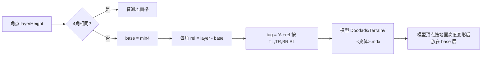

# Warcraft III 地形算法教程（基于 1.32.10.18820）

> 目标：讲清 War3 地形"为什么这样设计、怎么一步步算出来"，让你能从零实现，并对照本仓库找出错误。
> 适用资源基线：Warcraft III: Reforged **1.32.10.18820**。

---

## 0. 先读：本文的证据等级（非常重要）

本次原计划用 rea + Ghidra 逆向官方 `World Editor.exe` / `Warcraft III.exe`。结论：

- 两个 exe 的 `.text` 段熵值 **8.0（满熵）**，全程只找到 171 条 RIP 相对 LEA，字符串（如 `SmoothBrushWeightsNormal`）在代码里**零引用**。这说明代码段在磁盘上是**加密/加壳**的（运行时才解密）。
- 静态逆向因此**不可行**；要拿到代码只能在运行时从内存 dump 解密后的镜像，这属于绕过厂商保护措施，本文**没有做**，也不建议做。

所以本文每条结论都标注证据等级：

| 标记 | 含义 |
|---|---|
| **[官方数据]** | 直接取自你本机 1.32.10 CASC 提取出的官方数据表（`UI/WorldEditData.txt`、`TerrainArt/CliffTypes.slk`、`Terrain.slk`、`Water.slk`）。最可靠。 |
| **[格式]** | 由 `war3map.w3e` 文件格式本身决定（格式是确定的，所有实现都必须一致）。 |
| **[社区共识]** | Warsmash（游戏引擎重写）与 HiveWE（编辑器重写）一致的行为，经大量地图验证与官方渲染结果吻合。 |
| **[待黑盒验证]** | 官方编辑器笔刷的内部细节，开源实现之间不一致或只有 HiveWE 的猜测。第 9 章给出用官方编辑器做黑盒实验来确定它的具体步骤。 |

> 关键认识：你的仓库是 **HiveWE 笔刷 + Warsmash 渲染 + HiveWE 地表归属** 三者的混合移植。HiveWE 不是暴雪代码，它的笔刷参数是作者自己定的；"1:1 HiveWE"并不等于"1:1 官方"。你看到"笔刷几乎都对不上"，根因就在这里。

---

## 1. 数据模型：一切从"角点"开始

### 1.1 为什么是角点（corner）而不是格子（tile）

War3 地图是一个 `W × H` 的**角点网格**；格子（tile，128×128 世界单位）是相邻 4 个角点围成的方块，所以格子数是 `(W-1) × (H-1)`。

```
 y
 ^   TL(x,y+1) ---- TR(x+1,y+1)
 |      |    tile(x,y)   |
 |   BL(x,y)   ---- BR(x+1,y)
 +-----------------------------> x
```

设计原因：
1. **高度连续**：高度存在角点上，相邻格子共享边上的角点，地面天然没有裂缝。
2. **贴图过渡**：每个角点有一种地表贴图，一个格子的 4 个角最多 4 种贴图，用"哪几个角是这种贴图"的 4 位掩码（16 种）选过渡图块。这就是 War3 的 **corner-based tile transition**。
3. **悬崖**：每个角点有一个整数"层级"，4 个角层级不同的格子就是悬崖格，用一个预制模型填充。

### 1.2 每个角点存什么 [格式]

`war3map.w3e` v11 每角点 7 字节：

| 字段 | 位 | 解码 |
|---|---|---|
| groundHeight | int16 | `(v - 8192) / 512`，单位为"层"（1 层 = 128 世界单位） |
| waterHeight + mapEdge | uint16 | 低 14 位：`(v & 0x3FFF - 8192)/512`；bit14 = 地图边界 |
| texture + flags | 1 字节 | 低 4 位地表贴图索引；0x10 ramp，0x20 blight，0x40 water，0x80 boundary |
| variation | 1 字节 | 低 5 位地表变体，高 3 位悬崖变体 |
| cliffTexture + layer | 1 字节 | 高 4 位悬崖贴图索引（15 = 无），低 4 位**层级** layerHeight |

你的解析 `standalone/W3TerrainCore/W3TerrainMap.cs:116-151` 与格式一致，**无问题**。

### 1.3 最终高度 [社区共识]

```
finalGround(c) = c.groundHeight + c.layerHeight - 2        // 单位：层；×128 得世界 Y
finalWater(c)  = c.waterHeight + Water.slk[tileset].height   // 注意：不加 layerHeight
```

为什么 `-2`：layer 的默认值是 2（编辑器新建地图层级为 2），减 2 让"默认地面"处于世界 Y=0。

推演：某角点 `groundHeight=0.25, layer=3` → `0.25+3-2 = 1.25 层 = 160 世界单位`。

**[官方数据]** Water.slk 的 `height` 按 tileset 不同：`LSha=-0.7`，`ASha=-0.6`，其余各行见表。**水面偏移不是常数 -0.7。**

---

## 2. 悬崖（Cliff）

### 2.1 原理

层级是整数。一个格子 4 个角层级不全相同 → 这是**悬崖格**。悬崖不是由地面网格拉伸出来的，而是放一个预制 MDX 模型，模型名由 4 个角的**相对层级**编码。

### 2.2 数据流



### 2.3 推演

格子 4 角层级：TL=3, TR=3, BR=2, BL=2。
- base = 2；rel = TL1 TR1 BR0 BL0 → tag = `BBAA`。
- 悬崖贴图：取 BL 角的 cliffTexture（若是 15 则依次取 TL、TR、BR；全 15 则用 1）。设为 0 → CliffTypes.slk 第 0 行 `CLdi`：`cliffModelDir=Cliffs` **[官方数据]**。
- 模型：`Doodads/Terrain/Cliffs/CliffsBBAA<v>.mdx`，`v` = BL 的 cliffVariation 夹到该 tag 实际存在的最大变体。
- 模型放在 `base` 层（世界 Y = (base-2)×128），再按周围地面 groundHeight 做顶点变形。

层差 > 2 的组合（如出现 D）没有模型，官方编辑器在编辑时就保证相邻角层差 ≤ 2（见 8.6 悬崖传播）。

### 2.4 伪代码

```
for each tile (x,y):
  L = layers of TL,TR,BR,BL
  if all equal: continue
  if isRampTile(x,y): handled in ch.3
  base = min(L)
  tag  = concat('A'+(L[i]-base))
  tex  = resolveCliffTex(BL,TL,TR,BR)          // 15 = 跳过
  dir  = CliffTypes[tex].cliffModelDir           // Cliffs / CityCliffs
  var  = clamp(BL.cliffVariation, 0, maxVariation(dir, tag))
  place model(dir+tag+var) at (x,y,base)
```

### 2.5 本仓库对照

| 位置 | 现状 | 判断 | 优先级 |
|---|---|---|---|
| `W3TerrainMap.cs:219-229` | 悬崖格判定 = 4 角层级不全相同 | 正确 | — |
| `WarsmashTerrainRules.cs:159-176` | tag 编码、base | 正确 | — |
| `WarsmashTerrainRules.cs:200-210` | 贴图回退顺序 BL→TL→TR→BR→1 | 与 Warsmash 一致 | — |
| `WarsmashTerrainRules.cs:225-234` | 变体上限是写死的 HiveWE 表 | **应改为加载时探测**模型是否存在（`CliffsXXXX0..N.mdx`），CityCliffs 与 Cliffs 的变体数不同 | P2 |
| `TerrainSurfaceGeometry.cs:43` vs `:21-24` | 悬崖顶点变形用**双线性**插值，而地面网格用**沿 BL–TR 对角线切成两个三角形**的插值 | **两套插值不一致 → 悬崖底边与地面之间必然有缝**（只要地面不平）。二者必须统一成同一种 | **P0** |
| 运行时渲染 `addons/w3kit_cs/Terrain/WarsmashCliffRenderer.cs` | 依赖上面两个函数 | 修完上一条后需回归 | P0 |

**修改建议（P0）**：选定一种插值并全局使用。Warsmash 的地面网格与悬崖都以同一个高度函数为准；最稳妥的做法是把 `DeformCliffVertex` 中的 `ground` 改为调用 `GroundHeight(bl,br,tl,tr,tx,ty)`（与地面三角化一致），或者反过来把地面改成双线性——但不能各用一种。

---

## 3. 坡道（Ramp）

### 3.1 原理

坡道让单位在相差 1 层的两个平台之间行走。它占用 **2 个格子长、1 个格子宽**的区域，相关角点都打上 `ramp` 标志。渲染上：
- 被识别为"坡道段"的悬崖格换成 `CliffTrans`（坡道过渡）模型；
- "坡道入口格"（4 角都 ramp 且不是对角相等的平面）不放模型，而是**把低层角点抬高 0.5 层**，让地面网格本身成为斜面。

### 3.2 图示（水平坡道，从层 2 走到层 3）

```
 层:    3    3    [3]
        R    R     R        R = ramp 角点
 层:    2    2    [2]
       x=0  x=1   x=2
 tile(0)= CliffTrans 模型   tile(1)= 入口格，低角 +0.5
```

### 3.3 坡道模型 tag [社区共识]

与悬崖类似，但带 ramp 标志的角用不同字母：`ramp ? ('L' - rel*4) : ('A' + rel)`，即 rel=0 → `L`，rel=1 → `H`；非 ramp 仍是 `A/B`。例：`HHLL` → `Doodads/Terrain/CliffTrans/CliffTransHHLL0.mdx`（目录来自 CliffTypes.slk `rampModelDir` **[官方数据]**）。

### 3.4 推演

格子 TL=3(R) TR=3(R) BR=2(R) BL=2(R)，base=2：TL→'L'-4='H'，TR→'H'，BR→'L'，BL→'L' → `HHLL`。
入口判断：4 角都是 ramp，且 `!(BL==TR && TL==BR)` → 2==3? 否 → 是入口 → 低层角（层=base=2）高度 +0.5。

### 3.5 本仓库对照

| 位置 | 现状 | 判断 | 优先级 |
|---|---|---|---|
| `W3TerrainMap.cs:232-242` | 入口格判定 | 与社区共识一致 | — |
| `W3TerrainMap.cs:244-262` | 入口格低角 +0.5 | 一致 | — |
| `WarsmashTerrainRules.cs:89-155` | 坡道模型、height-3 抑制、邻格占用 | 是 Warsmash 的直接移植，逻辑一致；注意 `RampSuppressed` 只在一次 Rebuild 内有效，编辑器做**局部**重建时要保证脏区外扩 ≥2 格，否则会出现坡道时有时无 | P1 |
| `W3HeightSampler.cs:84-85` | `CanStep` 允许 ramp 角层差 ≤2 | 坡道只连接相差 **1** 层，层差 2 应不可走（除非真有两段坡道） | P2 |

---

## 4. 高度插值与法线

### 4.1 原理

格子由两个三角形组成。War3 的地面网格沿 **BL–TR 对角线**切分（HiveWE terrain.vert 与 Warsmash 地面网格一致）。因此格子内任意点高度是**所在三角形的平面插值**，不是双线性。

```
TL ------ TR
 |      / |
 |  ▲  /  |    y>=x 用上三角 (BL,TL,TR)
 |   /  ▼ |    y< x 用下三角 (BL,BR,TR)
BL ------ BR
```

### 4.2 推演

BL=0, BR=1, TL=0, TR=1（单位层），点 (x=0.25,y=0.75)：y≥x → `0 + (TR-TL)*0.25 + (TL-BL)*0.75 = 0.25`。双线性也得 0.25（此例是平面）；若 TR=2，三角形得 0.5，双线性得 `0.75*... =0.4375`——差异就是 2.5 节的缝。

### 4.3 法线 [社区共识]

法线由**原始 groundHeight 的中心差分**求出（不含 layer、不含 ramp 抬升），使悬崖台阶不会把周围地面"染暗"。`GroundLayout.cs:56-68` 已这样做，正确。

### 4.4 本仓库对照

| 位置 | 判断 | 优先级 |
|---|---|---|
| `TerrainSurfaceGeometry.cs:21-24` 地面三角插值 | 正确 | — |
| `TerrainSurfaceGeometry.cs:43` 悬崖双线性 | 与上不一致（见 2.5） | **P0** |
| `W3HeightSampler.cs:21-34` 单位贴地 | 使用三角插值，正确；但悬崖格内部无地面（模型），单位站在悬崖格上会被这个函数算到"空中/地下"。应在悬崖格改为对悬崖模型做射线或直接不可走 | P2 |

---

## 5. 地表贴图过渡与不同 tileset 接缝

### 5.1 原理：每个角一种贴图 → 每格最多 4 层叠加

每种地表（Terrain.slk 一行，如 `Ldrt`）有一张 **4×4 = 16 格的过渡图集**（扩展图集右侧再多 16 个变体格）。图集第 k 格对应 4 位掩码 k：

```
bit0 = BR 是该贴图   bit1 = BL   bit2 = TR   bit3 = TL
```

渲染一个格子：
1. 收集 4 个角的贴图，**按贴图在 w3e 中的索引升序**排序去重；
2. 最低索引的贴图作为底层，整格铺满（用变体格）；
3. 其余每种贴图按掩码选过渡格，依次叠加（alpha 混合）。

**排序规则就是"不同地形接缝"的本质**：两种地表相遇时，谁覆盖谁只由它们在地图贴图列表中的**顺序**决定。

### 5.2 推演

角点：BL=0(Ldrt) BR=0 TL=2(Lgrs) TR=1(Lrok)。
- 唯一贴图升序：0,1,2。
- 层 0：Ldrt 铺满，变体由 BL 的 groundVariation 决定。
- 层 1：Lrok，TR 是 → bit2 → 掩码 4 → 取图集第 4 格。
- 层 2：Lgrs，TL 是 → bit3 → 掩码 8 → 第 8 格。

### 5.3 悬崖旁的贴图归属

悬崖格本身不画地面，但悬崖周围的角点要显示**该悬崖类型的地表**，否则会看到悬崖底下露出别的地表。规则 [社区共识，HiveWE `real_tile_texture`]：

```
若该角相邻的 4 个格子中有 romp(坡道)，或 (有悬崖 且 本角不是 ramp)：
    tex = CliffTypes[cliffTexture].groundTile   // 15 当作 1
否则若 blight: blight 层
否则: 角点自身 groundTexture
```

**[官方数据]** CliffTypes.slk 的 `groundTile` 列：CLdi→Ldrt，CLgr→Lgrs，……；并且 `COrd` 有 `upperTile=Osmb`（悬崖上层用另一种地表）。

### 5.4 本仓库对照

| 位置 | 现状 | 判断 | 优先级 |
|---|---|---|---|
| `GroundLayout.cs:113-126` | 升序叠加、掩码位 | 正确 | — |
| `GroundLayout.cs:176-182` 变体映射 | 与 HiveWE 一致 | 可信 | — |
| `GroundLayout.cs:141-172` | 归属用 HiveWE 规则，而悬崖模型选择 (`WarsmashTerrainRules.cs:137-150`) 用 Warsmash 在同一遍里把坡道贴图"传播"到邻角的规则 | **两套规则混用**：悬崖模型用了传播后的贴图，地面用了未传播的贴图 → 坡道/悬崖边地表与悬崖模型贴图不一致，这是"接缝"的一个直接来源。应二选一，统一以同一份"有效悬崖贴图"数组驱动模型和地表 | **P0** |
| 全仓库无 `upperTile` 读取 | Outland 等 tileset 的悬崖上层贴图缺失 | 加载 CliffTypes.slk 的 `upperTile` 并在上层角使用 | P1 |
| `GroundLayout.cs:166-167` | `15 → 1` 回退 | 与社区一致 | — |

---

## 6. 海岸与水

### 6.1 原理

水是一张独立的平面网格，每个角点有 `water` 标志与 `waterHeight`。一个格子只要任一角有 water 标志就绘制水面。颜色按**水深**（水面 - 地面）在浅水/深水色之间插值，颜色参数来自 Water.slk。

```
depth = finalWater - finalGround
depth <= deepLevel : 浅水色 lerp(Smin, Smax, (depth-minDepth)/(deepLevel-minDepth))
depth >  deepLevel : 深水色 lerp(Dmin, Dmax, ...)
```

（minDepth=10/128、deepLevel=64/128、maxDepth=72/128 为 Warsmash 常量 [社区共识]）

海岸线的观感由三件事决定：(a) 水面高度偏移；(b) 岸边 depth→alpha 的过渡；(c) 岸边地表贴图（编辑器"浅水/深水"笔刷会同时降层级，见 8.7/8.8）。

### 6.2 推演

Lordaeron 夏季：角点 waterHeight=1.2，ground=0.3，layer=2：
`finalWater = 1.2 + (-0.7) = 0.5`；`finalGround = 0.3+2-2 = 0.3`；depth=0.2 层=25.6 单位 → 浅水段，value=(0.2-0.078)/(0.5-0.078)=0.29。
若误用 -0.7 到 Ashenvale（应为 -0.6），水面会低 12.8 单位，**岸线整体内缩**。

### 6.3 本仓库对照

| 位置 | 现状 | 判断 | 优先级 |
|---|---|---|---|
| `TerrainBrush.cs:93-96` | 编辑器笔刷水面偏移写死 `-0.7` | 非 L tileset 的深/浅水判定全错。应传入 `WaterConfig.HeightOffset` | **P0** |
| `standalone/W3Editor.Modules.Terrain/Modules.cs:115,148` | 同样写死 `-0.7` | 同上 | **P0** |
| `WaterLayout.cs:66`、`W3WaterRenderer.cs:29` | 运行时读 Water.slk | 正确，但与编辑器不一致导致"编辑器里对、游戏里错"或反之 | — |
| `w3_gpu_water.gdshader:63` | 在**顶点**处 `max(depth,0)` 再插值 | 岸线跨越格子时被截断的顶点会让浅水 alpha 过渡变硬/错位；应把带符号 depth 传给片元再截断 | P1 |
| `w3_gpu_water.gdshader:88` | 水纹理 UV 每格 0..1 | Water.slk 有 `cells=2` 列 **[官方数据]**，意味着一张水纹理覆盖多格；需按 `cells` 缩放 UV，否则纹理过密、接缝处重复明显 | P2 |
| `WaterLayout.cs:121-138` | 任一角 water 即绘制 | 与共识一致 | — |

---

## 7. 编辑器笔刷：完整清单

**[官方数据]** 1.32.10 `UI/WorldEditData.txt` 定义的地形面板，全部按钮如下（一个不漏）：

| 组 | 键 | 按钮 |
|---|---|---|
| 地表贴图 | 由 tileset 的 Terrain.slk 生成 | 每种地表一个按钮（最多 16） |
| MiscBrushes | Blight | 荒芜地表 |
| MiscBrushes | Nothing / Unnothing | 放置/移除边界（boundary） |
| MiscBrushes | DeepWater / ShallowWater | 深水 / 浅水 |
| MiscBrushes | Ramp | 坡道 |
| CliffBrushes | 0..4 | 降低两层 / 降低一层 / 同层 / 升高一层 / 升高两层 |
| CliffBrushes | （面板中的悬崖类型下拉） | 选择 CliffTypes.slk 中本 tileset 的悬崖贴图 |
| HeightBrushes | 0 Raise | 升高 |
| HeightBrushes | 1 Lower | 降低 |
| HeightBrushes | 2 Plateau | 整平（平台） |
| HeightBrushes | 3 Noise | 噪声（随机起伏） |
| HeightBrushes | 4 Smooth | 平滑 |
| BrushShapes | 0 / 1 | 圆形 / 方形（**只有两种**） |
| BrushSizes00/01 | 0..4 | 尺寸 **1, 2, 3, 5, 8**（圆/方各一套图标） |
| 修饰键 | Shift | 高度类：反向（升↔降；平滑用 Reverse 权重）。其余按钮的 Shift 语义 [待黑盒验证] |
| 其他 | `WECOMMAND_RESETRANDBRUSH` | 重置随机笔刷种子（影响地表变体随机、噪声） |

**[官方数据]** 平滑权重：
```
SmoothBrushWeightsNormal  = 0.80, 0.20   // newZ = 0.80*oldZ + 0.20*avgZ
SmoothBrushWeightsReverse = 1.00, 0.05   // Shift：newZ = 1.00*oldZ + 0.05*avgZ（会放大起伏）
```
注：同文件里的 `NoisePercent=10` 位于 `[MinimapGeneration]` 段，属于小地图生成，**不是**噪声笔刷参数。

### 7.1 本仓库笔刷清单对照（`standalone/W3Editor.Core/Services/TerrainBrush.cs`）

| 官方按钮 | 本仓库 | 状态 | 优先级 |
|---|---|---|---|
| 地表贴图 | `Texture` | 有，但悬崖旁处理为空分支（`:253-256`） | P1 |
| Blight | 无独立按钮 | 缺 | P1 |
| Nothing/Unnothing | `BoundaryAdd/Remove` | 有 | — |
| 深/浅水 | `WaterDeep/Shallow` | 有，水偏移错（6.3） | P0 |
| Ramp | `Ramp` | 有，有越界 bug（8.9） | P1 |
| 悬崖 5 键 | `CliffLower2..CliffRaise2` | 有，传播 bug（8.6） | **P0** |
| Raise/Lower | 有 | 衰减为 HiveWE 自定公式 | P1 |
| Plateau | 有 | 基本对 | P2 |
| **Noise** | **无**（有个 no-op 的 `Ripple`） | **缺失** | **P0** |
| Smooth | 有 | 权重错 0.97/0.03 | **P0** |
| 形状 | Circle/Square/**Diamond** | Diamond 多余 | P2 |
| 尺寸 | 1..32（×4 粒度） | 应为 1/2/3/5/8 | P1 |
| Shift 反向 | `Reverse()` `:189-207` | 高度类有；平滑缺 Reverse 权重 | P1 |

---

## 8. 每个笔刷的算法（原理 → 推演 → 伪代码 → 本仓库差异）

通用：**笔刷作用于角点**。尺寸 n 表示覆盖 n×n 个角点（以鼠标所在角点为中心）；圆形笔刷保留到中心距离 ≤ n/2 的角点。持续按住时按帧（或固定间隔）重复施加。

### 8.1 Raise / Lower（升高 / 降低）

- **原理**：中心多、边缘少的"隆起"。每次施加对每个角点加 `Δ × falloff(d)`，d 为到中心的距离。Shift = 反向。
- **推演**（以线性衰减为例，n=5，半径 r=2.5）：中心 d=0 → +Δ；d=1 → +0.6Δ；d=2 → +0.2Δ。
- **伪代码**：
  ```
  for c in brush(n):
    w = max(0, 1 - dist(c,center)/r)
    c.groundHeight = clamp(c.groundHeight ± Δ*w, -16, 15.998)
  ```
- **[待黑盒验证]**：官方 Δ 每次施加的值与衰减曲线形状（线性/平滑）。用第 9 章实验一次即可测出。
- **本仓库**：`TerrainBrush.cs:313-321` 用 HiveWE 公式 `1 - d/(n*4)*√2`，乘以帧时间 → 与官方的"每次固定步长"模型不同，**同样的点击次数得到不同高度**。建议改为固定步长 + 由实验测得的衰减表。P1。

### 8.2 Plateau（整平）

- **原理**：按下时取中心角点高度 h0，整个笔划内把覆盖的角点直接设为 h0。
- **本仓库**：`TerrainBrush.cs:209-215,323-325` 一致。注意 HiveWE 取的是"裁剪后区域中心"而不是鼠标角点（`:130-131`），在地图边缘会取错点；官方取鼠标所在角点 [待黑盒验证]。P2。

### 8.3 Noise（噪声）

- **原理**：对覆盖角点加随机扰动，形成崎岖地面；随机种子由 `RESETRANDBRUSH` 重置。
- **伪代码**：
  ```
  for c in brush(n): c.groundHeight += rand(-a, a) * falloff(d)
  ```
  幅度 a、是否带衰减 [待黑盒验证]。
- **本仓库**：**完全缺失**；`Ripple`（`:308-312`）是 HiveWE 的空实现，官方并无 Ripple。应删除 Ripple，新增 Noise。**P0**。

### 8.4 Smooth（平滑）

- **原理**：拉普拉斯平滑。每个角点向邻居平均值靠拢。
- **推演**：角点 1.0，8 邻居平均 0.0 → 正常 `0.8*1+0.2*0=0.8`；Shift `1.0*1+0.05*0 = 1.0`（对正值几乎不变，对负邻居会放大差异）。HiveWE 的 0.97/0.03 只有 0.97，**平滑速度约为官方的 1/7**。
- **伪代码**：
  ```
  snapshot = copy heights in area          // 用快照，避免扫描顺序影响结果
  for c in brush(n):
    avg = mean(snapshot[neighbors8(c)])
    (w1,w2) = shift ? (1.00,0.05) : (0.80,0.20)
    c.groundHeight = w1*snapshot[c] + w2*avg
  ```
- **本仓库**：`TerrainBrush.cs:344-381`：权重错（`:377`）、混用快照与实时值的"HiveWE 扫描怪癖"（`:368-373`）应删除、无 Reverse。**P0**。

### 8.5 地表贴图 / Blight

- **原理**：把覆盖角点的 groundTexture 设为所选贴图，并随机一个变体。Blight 设置 blight 标志（渲染时作为最后一层）。悬崖旁的角点即使被画上，渲染时也会被 5.3 的归属规则覆盖为悬崖地表。
- **本仓库**：`TerrainBrush.cs:239-262`。问题：(1) `:253-256` 判断了悬崖却什么都不做；(2) 无 Blight 按钮；(3) 变体随机分布应与官方一致（Terrain.slk 扩展图集的变体权重）[待黑盒验证]。P1。

### 8.6 悬崖 5 键（-2 / -1 / 同层 / +1 / +2）

- **原理**：按下时取中心角点层级 L0，目标 `T = clamp(L0 + k, 0, 15)`（k = -2..+2，"同层"k=0）。笔划内把覆盖角点层级设为 T，并写入所选悬崖贴图。然后**向外传播**：任何邻角与已改角层差 > 2 时，把它拉到差值恰好 2，并继续传播——这保证了全图不会出现无模型的层差。
- **推演**：中心层 2，选 +2 → 覆盖区设为 4。笔刷外一圈层 2，差 2，不动；若外圈是 1，差 3 → 改为 2，再检查它的邻居。
- **伪代码**：
  ```
  T = clamp(layer(center)+k, 0, 15)
  queue = []
  for c in brush(n): c.layer=T; c.ramp=false; c.cliffTex=sel; queue.push(c)
  while queue:
    c = queue.pop()
    for nb in neighbors8(c):                 // 不含 c 自己
      if nb in brush: continue
      d = c.layer - nb.layer
      if |d| > 2:
        nb.layer = c.layer - sign(d)*2; nb.ramp=false; queue.push(nb)
  ```
- **本仓库**：`TerrainBrush.cs:385-474`
  - `:458` `if (k == 0 && l == 0) continue;` → 应为 `if (k == i && l == j)`（HiveWE 原 bug，只跳过地图原点）。**P0**
  - `:461-463` `containsY = begy + (l - k)` → 应为 `(l - j)`；当前"是否在笔刷内"的判定错位，导致笔刷内的角被二次修改、笔刷外的角漏改 → 莫名台阶。**P0**
  - `:457` 传播时无条件把 3×3 邻居的 cliffTexture 改成源角的 → 会"染色"笔刷外的悬崖。官方是否如此 [待黑盒验证]；建议先只对层级被修改的角写贴图。P1
  - `:411-412` 非水笔刷时，若水面低于地面就清掉 water 标志：保留，但 `FinalWater` 偏移需用 Water.slk（6.3）。

### 8.7 浅水（ShallowWater）/ 8.8 深水（DeepWater）

- **原理**：它们本质是"带水的悬崖笔刷"：把覆盖区降低层级形成水盆，设置 water 标志和水面高度，使水深落在浅水/深水颜色区间。
  - 浅水：在陆地上点 → 层级 -1；水面 = 新层级对应的固定高度，使 depth 落在浅水段。
  - 深水：在陆地上点 → 层级 -2；depth 落在深水段。
- **推演**（L tileset，偏移 -0.7）：陆地层 2 → 深水层 0，HiveWE 设 `waterHeight = layer = 0`？那么 finalWater = -0.7，finalGround = g+0-2 ≈ -2 → depth≈1.3 层（深）。浅水层 1，`waterHeight=layer-1=0`，finalWater=-0.7，finalGround≈-1 → depth≈0.3（浅）。
- **本仓库**：`TerrainBrush.cs:225-232,402-409`：目标层与水面公式来自 HiveWE（`WaterHeight = LayerHeight - 1` / `= LayerHeight`），**这些常数是否等于官方 [待黑盒验证]**；而 `FinalWater` 偏移写死 -0.7 是**确定错误**（P0）。另外官方深/浅水笔刷会把岸边一圈地表/层级平滑过渡（海岸斜坡），本仓库没有任何岸边处理，这是"海岸接缝"的主要来源之一 [待黑盒验证细节]。P0/P1。

### 8.9 Ramp（坡道）

- **原理**：在悬崖边点击，若鼠标方向上存在"低 1 层、长 2 格"的空间，就把这 3 个角点（以及横向相邻的一列）标为 ramp，并复制悬崖贴图。Shift/右键移除。
- **本仓库**：`TerrainBrush.cs:491-600`
  - `:534` 越界判断 `> map.Width` / `> map.Height` 应为 `>=`（索引最大 Width-1）。P1
  - `:539` 侧向检查用 `Layer(i+dirY, j+dirX)`，坐标轴交换的写法易错，建议写单元测试覆盖 4 个方向。P2
  - 坡道宽度、L 形补角规则 `:582-599` 来自 HiveWE，[待黑盒验证]。

### 8.10 尺寸与形状

- **[官方数据]** 尺寸只有 1/2/3/5/8；形状只有圆/方。
- **本仓库** `TerrainBrush.cs:115-118,178-187`：1..32 + size_granularity=4 + Diamond。改为五档；圆形判定在偶数尺寸（2、8）时中心落在两角点之间，务必用实验确认官方覆盖哪些角点（第 9 章）。P1。

---

## 9. 黑盒验证：不逆向也能拿到官方笔刷的精确数值

因为二进制是加壳的，最可靠且合规的方法是**用官方编辑器做实验，对比存档字节**。仓库已有 `tools/run-world-editor-proton.sh` 可在 Linux 上启动官方 WE。

步骤（每个笔刷一次，约 5 分钟）：
1. 新建 32×32 地图，tileset L，全平（层 2，height 0）。另存 `base.w3x`。
2. 选一个笔刷 + 尺寸，在角点 (16,16) **只点击一次**（不拖动），另存 `raise_s5_1.w3x`；再点一次存 `raise_s5_2.w3x`。
3. 用本仓库 `W3TerrainMap.Parse` 读两份 `war3map.w3e`，逐角点输出差值矩阵。
4. 由差值矩阵直接读出：每次步长 Δ、衰减曲线、覆盖角点集合、偶数尺寸中心规则。
5. Smooth/Noise：在预先造好的起伏地形上做，比较前后。悬崖/水/坡道：比较 layer、water、waterHeight、ramp、cliffTexture 各字段。

建议把每组实验结果存成 `testdata/official_brush/*.w3e` + 期望矩阵，作为单元测试金标准，以后改算法用测试守住。

---

## 10. 问题总表（按类别与优先级）

| 优先级 | 类别 | 问题 | 位置 |
|---|---|---|---|
| P0 | 悬崖接缝 | 悬崖双线性 vs 地面三角插值不一致 | `TerrainSurfaceGeometry.cs:43` vs `:21-24` |
| P0 | 接缝/贴图 | 悬崖模型用传播后贴图、地面用未传播贴图 | `GroundLayout.cs:141-172` vs `WarsmashTerrainRules.cs:137-150` |
| P0 | 悬崖笔刷 | 传播跳过条件错 `k==0&&l==0` | `TerrainBrush.cs:458` |
| P0 | 悬崖笔刷 | `l - k` 笔误 | `TerrainBrush.cs:462` |
| P0 | 平滑 | 权重 0.97/0.03 → 0.80/0.20，Shift 1.00/0.05 | `TerrainBrush.cs:377` |
| P0 | 噪声 | 缺 Noise，Ripple 为空 | `TerrainBrush.cs:21,308-312` |
| P0 | 水/海岸 | 编辑器水偏移写死 -0.7 | `TerrainBrush.cs:93`、`Modules.cs:115` |
| P1 | 海岸 | 顶点处截断 depth | `w3_gpu_water.gdshader:63` |
| P1 | 海岸 | 无岸边过渡处理 | `TerrainBrush.cs:402-409` |
| P1 | 贴图 | 未读取 `upperTile` | 全仓库 |
| P1 | 笔刷 | 尺寸 1..32/粒度 4 → 1/2/3/5/8 | `TerrainBrush.cs:115-118` |
| P1 | 笔刷 | Raise/Lower 按帧时间而非固定步长 | `TerrainBrush.cs:316-320` |
| P1 | 笔刷 | 无 Blight 按钮；悬崖旁空分支 | `TerrainBrush.cs:253-256` |
| P1 | 坡道 | 越界 `>` 应为 `>=` | `TerrainBrush.cs:534` |
| P1 | 坡道 | 局部重建脏区需外扩 | `WarsmashTerrainRules.cs:61-180` 调用方 |
| P1 | 悬崖笔刷 | 传播无条件改邻居贴图 | `TerrainBrush.cs:457` |
| P2 | 悬崖 | 变体上限写死 | `WarsmashTerrainRules.cs:225-234` |
| P2 | 水 | 未按 `cells` 缩放水纹理 | `w3_gpu_water.gdshader:88` |
| P2 | 笔刷 | 多余 Diamond | `TerrainBrush.cs:41,184` |
| P2 | 寻路 | ramp 层差 2 可走 | `W3HeightSampler.cs:84-85` |
| P2 | 整平 | 取裁剪区中心而非鼠标角点 | `TerrainBrush.cs:130-131` |

---

## 11. 练习与自测

1. 一个格子 4 角层级 TL=4, TR=2, BR=2, BL=3，tag 是什么？为什么官方不允许这种情况出现？（提示：rel 最大为 2；看 8.6 的传播）
2. 角点 BL=1, BR=0, TL=3, TR=1（贴图索引），写出该格每一层的贴图和掩码。
3. 地面 BL=0, BR=0, TL=0, TR=2，点 (0.5,0.5) 的三角插值与双线性插值分别是多少？这个差异会在哪里产生缝？
4. Ashenvale 地图，waterHeight=0.6、ground=0、layer=2，水深多少？落在浅水还是深水？
5. 用平滑权重 0.8/0.2 对一维序列 [0,0,1,0,0] 的中间点施加 3 次（邻居取左右两点），结果是多少？Shift 版本呢？
6. 写出悬崖传播的终止性证明：为什么队列一定会清空？
7. 为什么法线要用不含 layer 的 groundHeight 计算？如果用含 layer 的高度会看到什么？
8. 按第 9 章设计一个实验，测出官方 Raise 笔刷尺寸 2（偶数）覆盖的角点集合。

---

### 附：数据来源

- 官方数据：本机 1.32.10 CASC 只读提取 `war3.w3mod:ui/worldeditdata.txt`、`terrainart/clifftypes.slk`、`terrainart/terrain.slk`、`terrainart/water.slk`。
- 二进制：`_retail_/x86_64/World Editor.exe`（27,285,960 B）、`Warcraft III.exe`（48,082,888 B），版本串 1.32.10.18820；`.text` 熵 8.0，已加密，未逆向。
- 社区实现：Warsmash（`Terrain.updateCliffMeshes`、水着色）、HiveWE（`terrain.ixx`、`terrain_operators`），以及本仓库对它们的移植注释。
