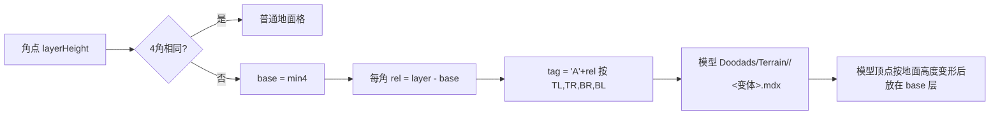

# Warcraft III 地形算法教程（基于 1.32.10.18820）

> 目标：讲清 War3 地形"为什么这样设计、怎么一步步算出来"，让你能从零实现，并对照本仓库找出错误。
> 适用资源基线：Warcraft III: Reforged **1.32.10.18820**。

---

## 0. 先读：本文的证据等级（非常重要）

本次原计划用 rea + Ghidra 逆向官方 `World Editor.exe` / `Warcraft III.exe`。结论：

- 两个 exe 的 `.text` 段熵值 **8.0（满熵）**，全程只找到 171 条 RIP 相对 LEA，字符串（如 `SmoothBrushWeightsNormal`）在代码里**零引用**。这说明代码段在磁盘上是**加密/加壳**的（运行时才解密）。
- 静态逆向因此**不可行**；要拿到代码只能在运行时从内存 dump 解密后的镜像，这属于绕过厂商保护措施，本文**没有做**，也不建议做。

所以本文每条结论都标注证据等级：

| 标记 | 含义 |
|---|---|
| **[官方数据]** | 直接取自你本机 1.32.10 CASC 提取出的官方数据表（`UI/WorldEditData.txt`、`TerrainArt/CliffTypes.slk`、`Terrain.slk`、`Water.slk`）。最可靠。 |
| **[格式]** | 由 `war3map.w3e` 文件格式本身决定（格式是确定的，所有实现都必须一致）。 |
| **[社区共识]** | Warsmash（游戏引擎重写）与 HiveWE（编辑器重写）一致的行为，经大量地图验证与官方渲染结果吻合。 |
| **[实测]** | 第 12 章用官方编辑器做黑盒实验测得，附有存档数据和推导。 |
| **[待黑盒验证]** | 官方编辑器笔刷的内部细节，开源实现之间不一致或只有 HiveWE 的猜测。第 9 章给出用官方编辑器做黑盒实验来确定它的具体步骤。 |

> 关键认识：你的仓库是 **HiveWE 笔刷 + Warsmash 渲染 + HiveWE 地表归属** 三者的混合移植。HiveWE 不是暴雪代码，它的笔刷参数是作者自己定的；"1:1 HiveWE"并不等于"1:1 官方"。你看到"笔刷几乎都对不上"，根因就在这里。

---

## 1. 数据模型：一切从"角点"开始

### 1.1 为什么是角点（corner）而不是格子（tile）

War3 地图是一个 `W × H` 的**角点网格**；格子（tile，128×128 世界单位）是相邻 4 个角点围成的方块，所以格子数是 `(W-1) × (H-1)`。

```
 y
 ^   TL(x,y+1) ---- TR(x+1,y+1)
 |      |    tile(x,y)   |
 |   BL(x,y)   ---- BR(x+1,y)
 +-----------------------------> x
```

设计原因：
1. **高度连续**：高度存在角点上，相邻格子共享边上的角点，地面天然没有裂缝。
2. **贴图过渡**：每个角点有一种地表贴图，一个格子的 4 个角最多 4 种贴图，用"哪几个角是这种贴图"的 4 位掩码（16 种）选过渡图块。这就是 War3 的 **corner-based tile transition**。
3. **悬崖**：每个角点有一个整数"层级"，4 个角层级不同的格子就是悬崖格，用一个预制模型填充。

### 1.2 每个角点存什么 [格式]

`war3map.w3e` v11 每角点 7 字节：

| 字段 | 位 | 解码 |
|---|---|---|
| groundHeight | int16 | `(v - 8192) / 512`，单位为"层"（1 层 = 128 世界单位） |
| waterHeight + mapEdge | uint16 | 低 14 位：`(v & 0x3FFF - 8192)/512`；bit14 = 地图边界 |
| texture + flags | 1 字节 | 低 4 位地表贴图索引；0x10 ramp，0x20 blight，0x40 water，0x80 boundary |
| variation | 1 字节 | 低 5 位地表变体，高 3 位悬崖变体 |
| cliffTexture + layer | 1 字节 | 高 4 位悬崖贴图索引（15 = 无），低 4 位**层级** layerHeight |

你的解析 `standalone/W3TerrainCore/W3TerrainMap.cs:116-151` 与格式一致，**无问题**。

### 1.3 最终高度 [社区共识]

```
finalGround(c) = c.groundHeight + c.layerHeight - 2        // 单位：层；×128 得世界 Y
finalWater(c)  = c.waterHeight + Water.slk[tileset].height   // 注意：不加 layerHeight
```

为什么 `-2`：layer 的默认值是 2（编辑器新建地图层级为 2），减 2 让"默认地面"处于世界 Y=0。

推演：某角点 `groundHeight=0.25, layer=3` → `0.25+3-2 = 1.25 层 = 160 世界单位`。

**[官方数据]** Water.slk 的 `height` 按 tileset 不同：`LSha=-0.7`，`ASha=-0.6`，其余各行见表。**水面偏移不是常数 -0.7。**

---

## 2. 悬崖（Cliff）

### 2.1 原理

层级是整数。一个格子 4 个角层级不全相同 → 这是**悬崖格**。悬崖不是由地面网格拉伸出来的，而是放一个预制 MDX 模型，模型名由 4 个角的**相对层级**编码。

### 2.2 数据流



### 2.3 推演

格子 4 角层级：TL=3, TR=3, BR=2, BL=2。
- base = 2；rel = TL1 TR1 BR0 BL0 → tag = `BBAA`。
- 悬崖贴图：取 BL 角的 cliffTexture（若是 15 则依次取 TL、TR、BR；全 15 则用 1）。设为 0 → CliffTypes.slk 第 0 行 `CLdi`：`cliffModelDir=Cliffs` **[官方数据]**。
- 模型：`Doodads/Terrain/Cliffs/CliffsBBAA<v>.mdx`，`v` = BL 的 cliffVariation 夹到该 tag 实际存在的最大变体。
- 模型放在 `base` 层（世界 Y = (base-2)×128），再按周围地面 groundHeight 做顶点变形。

层差 > 2 的组合（如出现 D）没有模型，官方编辑器在编辑时就保证相邻角层差 ≤ 2（见 8.6 悬崖传播）。

### 2.4 伪代码

```
for each tile (x,y):
  L = layers of TL,TR,BR,BL
  if all equal: continue
  if isRampTile(x,y): handled in ch.3
  base = min(L)
  tag  = concat('A'+(L[i]-base))
  tex  = resolveCliffTex(BL,TL,TR,BR)          // 15 = 跳过
  dir  = CliffTypes[tex].cliffModelDir           // Cliffs / CityCliffs
  var  = clamp(BL.cliffVariation, 0, maxVariation(dir, tag))
  place model(dir+tag+var) at (x,y,base)
```

### 2.5 本仓库对照

| 位置 | 现状 | 判断 | 优先级 |
|---|---|---|---|
| `W3TerrainMap.cs:219-229` | 悬崖格判定 = 4 角层级不全相同 | 正确 | — |
| `WarsmashTerrainRules.cs:159-176` | tag 编码、base | 正确 | — |
| `WarsmashTerrainRules.cs:200-210` | 贴图回退顺序 BL→TL→TR→BR→1 | 与 Warsmash 一致 | — |
| `WarsmashTerrainRules.cs:225-234` | 变体上限是写死的 HiveWE 表 | **应改为加载时探测**模型是否存在（`CliffsXXXX0..N.mdx`），CityCliffs 与 Cliffs 的变体数不同 | P2 |
| `TerrainSurfaceGeometry.cs:43` vs `:21-24` | 悬崖顶点变形用**双线性**插值，而地面网格用**沿 BL–TR 对角线切成两个三角形**的插值 | **两套插值不一致 → 悬崖底边与地面之间必然有缝**（只要地面不平）。二者必须统一成同一种 | **P0** |
| 运行时渲染 `addons/w3kit_cs/Terrain/WarsmashCliffRenderer.cs` | 依赖上面两个函数 | 修完上一条后需回归 | P0 |

**修改建议（P0）**：选定一种插值并全局使用。Warsmash 的地面网格与悬崖都以同一个高度函数为准；最稳妥的做法是把 `DeformCliffVertex` 中的 `ground` 改为调用 `GroundHeight(bl,br,tl,tr,tx,ty)`（与地面三角化一致），或者反过来把地面改成双线性——但不能各用一种。

---

## 3. 坡道（Ramp）

### 3.1 原理

坡道让单位在相差 1 层的两个平台之间行走。它占用 **2 个格子长、1 个格子宽**的区域，相关角点都打上 `ramp` 标志。渲染上：
- 被识别为"坡道段"的悬崖格换成 `CliffTrans`（坡道过渡）模型；
- "坡道入口格"（4 角都 ramp 且不是对角相等的平面）不放模型，而是**把低层角点抬高 0.5 层**，让地面网格本身成为斜面。

### 3.2 图示（水平坡道，从层 2 走到层 3）

```
 层:    3    3    [3]
        R    R     R        R = ramp 角点
 层:    2    2    [2]
       x=0  x=1   x=2
 tile(0)= CliffTrans 模型   tile(1)= 入口格，低角 +0.5
```

### 3.3 坡道模型 tag [社区共识]

与悬崖类似，但带 ramp 标志的角用不同字母：`ramp ? ('L' - rel*4) : ('A' + rel)`，即 rel=0 → `L`，rel=1 → `H`；非 ramp 仍是 `A/B`。例：`HHLL` → `Doodads/Terrain/CliffTrans/CliffTransHHLL0.mdx`（目录来自 CliffTypes.slk `rampModelDir` **[官方数据]**）。

### 3.4 推演

格子 TL=3(R) TR=3(R) BR=2(R) BL=2(R)，base=2：TL→'L'-4='H'，TR→'H'，BR→'L'，BL→'L' → `HHLL`。
入口判断：4 角都是 ramp，且 `!(BL==TR && TL==BR)` → 2==3? 否 → 是入口 → 低层角（层=base=2）高度 +0.5。

### 3.5 本仓库对照

| 位置 | 现状 | 判断 | 优先级 |
|---|---|---|---|
| `W3TerrainMap.cs:232-242` | 入口格判定 | 与社区共识一致 | — |
| `W3TerrainMap.cs:244-262` | 入口格低角 +0.5 | 一致 | — |
| `WarsmashTerrainRules.cs:89-155` | 坡道模型、height-3 抑制、邻格占用 | 是 Warsmash 的直接移植，逻辑一致；注意 `RampSuppressed` 只在一次 Rebuild 内有效，编辑器做**局部**重建时要保证脏区外扩 ≥2 格，否则会出现坡道时有时无 | P1 |
| `W3HeightSampler.cs:84-85` | `CanStep` 允许 ramp 角层差 ≤2 | 坡道只连接相差 **1** 层，层差 2 应不可走（除非真有两段坡道） | P2 |

---

## 4. 高度插值与法线

### 4.1 原理

格子由两个三角形组成。War3 的地面网格沿 **BL–TR 对角线**切分（HiveWE terrain.vert 与 Warsmash 地面网格一致）。因此格子内任意点高度是**所在三角形的平面插值**，不是双线性。

```
TL ------ TR
 |      / |
 |  ▲  /  |    y>=x 用上三角 (BL,TL,TR)
 |   /  ▼ |    y< x 用下三角 (BL,BR,TR)
BL ------ BR
```

### 4.2 推演

BL=0, BR=1, TL=0, TR=1（单位层），点 (x=0.25,y=0.75)：y≥x → `0 + (TR-TL)*0.25 + (TL-BL)*0.75 = 0.25`。双线性也得 0.25（此例是平面）；若 TR=2，三角形得 0.5，双线性得 `0.75*... =0.4375`——差异就是 2.5 节的缝。

### 4.3 法线 [社区共识]

法线由**原始 groundHeight 的中心差分**求出（不含 layer、不含 ramp 抬升），使悬崖台阶不会把周围地面"染暗"。`GroundLayout.cs:56-68` 已这样做，正确。

### 4.4 伪代码

```
height_at(cell, x, y):            # 格内局部坐标 x, y ∈ [0,1)；沿 BL–TR 对角线切分
    h = {BL, BR, TL, TR}          # 4 角的世界高度（最终地面高）
    if y >= x:                    # 上三角 (BL, TL, TR)
        return h.BL + (h.TL - h.BL) * y + (h.TR - h.TL) * x
    else:                         # 下三角 (BL, BR, TR)
        return h.BL + (h.BR - h.BL) * x + (h.TR - h.BR) * y

normal(corner):                   # 中心差分；只用原始 groundHeight（不含 layer / ramp）
    dx = (g[x+1,y] - g[x-1,y]) / (2 * cellWidth)
    dy = (g[x,y+1] - g[x,y-1]) / (2 * cellWidth)
    return normalize(-dx, -dy, 1)
```

### 4.5 本仓库对照

| 位置 | 判断 | 优先级 |
|---|---|---|
| `TerrainSurfaceGeometry.cs:21-24` 地面三角插值 | 正确 | — |
| `TerrainSurfaceGeometry.cs:43` 悬崖双线性 | 与上不一致（见 2.5） | **P0** |
| `W3HeightSampler.cs:21-34` 单位贴地 | 使用三角插值，正确；但悬崖格内部无地面（模型），单位站在悬崖格上会被这个函数算到"空中/地下"。应在悬崖格改为对悬崖模型做射线或直接不可走 | P2 |

---

## 5. 地表贴图过渡与不同 tileset 接缝

### 5.1 原理：每个角一种贴图 → 每格最多 4 层叠加

每种地表（Terrain.slk 一行，如 `Ldrt`）有一张 **4×4 = 16 格的过渡图集**（扩展图集右侧再多 16 个变体格）。图集第 k 格对应 4 位掩码 k：

```
bit0 = BR 是该贴图   bit1 = BL   bit2 = TR   bit3 = TL
```

渲染一个格子：
1. 收集 4 个角的贴图，**按贴图在 w3e 中的索引升序**排序去重；
2. 最低索引的贴图作为底层，整格铺满（用变体格）；
3. 其余每种贴图按掩码选过渡格，依次叠加（alpha 混合）。

**排序规则就是"不同地形接缝"的本质**：两种地表相遇时，谁覆盖谁只由它们在地图贴图列表中的**顺序**决定。

### 5.2 推演

角点：BL=0(Ldrt) BR=0 TL=2(Lgrs) TR=1(Lrok)。
- 唯一贴图升序：0,1,2。
- 层 0：Ldrt 铺满，变体由 BL 的 groundVariation 决定。
- 层 1：Lrok，TR 是 → bit2 → 掩码 4 → 取图集第 4 格。
- 层 2：Lgrs，TL 是 → bit3 → 掩码 8 → 第 8 格。

### 5.3 悬崖旁的贴图归属

悬崖格本身不画地面，但悬崖周围的角点要显示**该悬崖类型的地表**，否则会看到悬崖底下露出别的地表。规则 [社区共识，HiveWE `real_tile_texture`]：

```
若该角相邻的 4 个格子中有 romp(坡道)，或 (有悬崖 且 本角不是 ramp)：
    tex = CliffTypes[cliffTexture].groundTile   // 15 当作 1
否则若 blight: blight 层
否则: 角点自身 groundTexture
```

**[官方数据]** CliffTypes.slk 的 `groundTile` 列：CLdi→Ldrt，CLgr→Lgrs，……；并且 `COrd` 有 `upperTile=Osmb`（悬崖上层用另一种地表）。

### 5.4 伪代码

```
render_tile(tile):
    corners = tile 的 4 个角
    texs = 去重({c.groundTexture for c in corners}，按地图贴图列表索引升序)
    base = texs[0]
    整格铺 base（用变体格，由持有 base 的角的 groundVariation 决定）
    for t in texs[1:]:
        mask = 0
        for (corner, bit) in [(BR,1), (BL,2), (TR,4), (TL,8)]:
            if corner.groundTexture == t: mask |= bit
        叠加 t 的过渡图集第 mask 格（alpha 混合）
```

### 5.5 本仓库对照

| 位置 | 现状 | 判断 | 优先级 |
|---|---|---|---|
| `GroundLayout.cs:113-126` | 升序叠加、掩码位 | 正确 | — |
| `GroundLayout.cs:176-182` 变体映射 | 与 HiveWE 一致 | 可信 | — |
| `GroundLayout.cs:141-172` | 归属用 HiveWE 规则，而悬崖模型选择 (`WarsmashTerrainRules.cs:137-150`) 用 Warsmash 在同一遍里把坡道贴图"传播"到邻角的规则 | **两套规则混用**：悬崖模型用了传播后的贴图，地面用了未传播的贴图 → 坡道/悬崖边地表与悬崖模型贴图不一致，这是"接缝"的一个直接来源。应二选一，统一以同一份"有效悬崖贴图"数组驱动模型和地表 | **P0** |
| 全仓库无 `upperTile` 读取 | Outland 等 tileset 的悬崖上层贴图缺失 | 加载 CliffTypes.slk 的 `upperTile` 并在上层角使用 | P1 |
| `GroundLayout.cs:166-167` | `15 → 1` 回退 | 与社区一致 | — |

---

## 6. 海岸与水

### 6.1 原理

水是一张独立的平面网格，每个角点有 `water` 标志与 `waterHeight`。一个格子只要任一角有 water 标志就绘制水面。颜色按**水深**（水面 - 地面）在浅水/深水色之间插值，颜色参数来自 Water.slk。

```
depth = finalWater - finalGround
depth <= deepLevel : 浅水色 lerp(Smin, Smax, (depth-minDepth)/(deepLevel-minDepth))
depth >  deepLevel : 深水色 lerp(Dmin, Dmax, ...)
```

（minDepth=10/128、deepLevel=64/128、maxDepth=72/128 为 Warsmash 常量 [社区共识]）

海岸线的观感由三件事决定：(a) 水面高度偏移；(b) 岸边 depth→alpha 的过渡；(c) 岸边地表贴图（编辑器"浅水/深水"笔刷会同时降层级，见 8.7/8.8）。

### 6.2 推演

Lordaeron 夏季：角点 waterHeight=1.2，ground=0.3，layer=2：
`finalWater = 1.2 + (-0.7) = 0.5`；`finalGround = 0.3+2-2 = 0.3`；depth=0.2 层=25.6 单位 → 浅水段，value=(0.2-0.078)/(0.5-0.078)=0.29。
若误用 -0.7 到 Ashenvale（应为 -0.6），水面会低 12.8 单位，**岸线整体内缩**。

### 6.3 伪代码

```
finalWater(corner)  = corner.waterHeight + Water.slk[waterType].heightOffset
finalGround(corner) = corner.groundHeight + corner.layer - 2
depth = finalWater - finalGround                 # 世界单位
if depth <= deepLevel:                           # 64/128 层（Warsmash 常量，社区共识）
    color = lerp(Smin, Smax, (depth - minDepth) / (deepLevel - minDepth))
else:
    color = lerp(Dmin, Dmax, (depth - deepLevel) / (maxDepth - deepLevel))
任一角有 water 标志 → 绘制该格水面
```

### 6.4 本仓库对照

| 位置 | 现状 | 判断 | 优先级 |
|---|---|---|---|
| `TerrainBrush.cs:93-96` | 编辑器笔刷水面偏移写死 `-0.7` | 非 L tileset 的深/浅水判定全错。应传入 `WaterConfig.HeightOffset` | **P0** |
| `standalone/W3Editor.Modules.Terrain/Modules.cs:115,148` | 同样写死 `-0.7` | 同上 | **P0** |
| `WaterLayout.cs:66`、`W3WaterRenderer.cs:29` | 运行时读 Water.slk | 正确，但与编辑器不一致导致"编辑器里对、游戏里错"或反之 | — |
| `w3_gpu_water.gdshader:63` | 在**顶点**处 `max(depth,0)` 再插值 | 岸线跨越格子时被截断的顶点会让浅水 alpha 过渡变硬/错位；应把带符号 depth 传给片元再截断 | P1 |
| `w3_gpu_water.gdshader:88` | 水纹理 UV 每格 0..1 | Water.slk 有 `cells=2` 列 **[官方数据]**，意味着一张水纹理覆盖多格；需按 `cells` 缩放 UV，否则纹理过密、接缝处重复明显 | P2 |
| `WaterLayout.cs:121-138` | 任一角 water 即绘制 | 与共识一致 | — |

---

## 7. 编辑器笔刷：完整清单

**[官方数据]** 1.32.10 `UI/WorldEditData.txt` 定义的地形面板，全部按钮如下（一个不漏）：

| 组 | 键 | 按钮 |
|---|---|---|
| 地表贴图 | 由 tileset 的 Terrain.slk 生成 | 每种地表一个按钮（最多 16） |
| MiscBrushes | Blight | 荒芜地表 |
| MiscBrushes | Nothing / Unnothing | 放置/移除边界（boundary） |
| MiscBrushes | DeepWater / ShallowWater | 深水 / 浅水 |
| MiscBrushes | Ramp | 坡道 |
| CliffBrushes | 0..4 | 降低两层 / 降低一层 / 同层 / 升高一层 / 升高两层 |
| CliffBrushes | （面板中的悬崖类型下拉） | 选择 CliffTypes.slk 中本 tileset 的悬崖贴图 |
| HeightBrushes | 0 Raise | 升高 |
| HeightBrushes | 1 Lower | 降低 |
| HeightBrushes | 2 Plateau | 整平（平台） |
| HeightBrushes | 3 Noise | 噪声（随机起伏） |
| HeightBrushes | 4 Smooth | 平滑 |
| BrushShapes | 0 / 1 | 圆形 / 方形（**只有两种**） |
| BrushSizes00/01 | 0..4 | 尺寸 **1, 2, 3, 5, 8**（圆/方各一套图标） |
| 修饰键 | Shift | 高度类：反向（升↔降；平滑用 Reverse 权重）。[实测] 坡道：Shift 移除；其余按钮 Shift 无效果（平滑用 1.00/0.05），见第 12 章 |
| 其他 | `WECOMMAND_RESETRANDBRUSH` | 重置随机笔刷种子（影响地表变体随机、噪声） |

**[官方数据]** 平滑权重：
```
SmoothBrushWeightsNormal  = 0.80, 0.20   // newZ = 0.80*oldZ + 0.20*avgZ
SmoothBrushWeightsReverse = 1.00, 0.05   // Shift：newZ = 1.00*oldZ + 0.05*avgZ（会放大起伏）
```
注：同文件里的 `NoisePercent=10` 位于 `[MinimapGeneration]` 段，属于小地图生成，**不是**噪声笔刷参数。

### 7.1 本仓库笔刷清单对照（`standalone/W3Editor.Core/Services/TerrainBrush.cs`）

| 官方按钮 | 本仓库 | 状态 | 优先级 |
|---|---|---|---|
| 地表贴图 | `Texture` | 有，但悬崖旁处理为空分支（`:253-256`） | P1 |
| Blight | 无独立按钮 | 缺 | P1 |
| Nothing/Unnothing | `BoundaryAdd/Remove` | 有 | — |
| 深/浅水 | `WaterDeep/Shallow` | 有，水偏移错（6.4） | P0 |
| Ramp | `Ramp` | 有，有越界 bug（8.9） | P1 |
| 悬崖 5 键 | `CliffLower2..CliffRaise2` | 有，传播 bug（8.6） | **P0** |
| Raise/Lower | 有 | 衰减为 HiveWE 自定公式 | P1 |
| Plateau | 有 | 基本对 | P2 |
| **Noise** | **无**（有个 no-op 的 `Ripple`） | **缺失** | **P0** |
| Smooth | 有 | 权重错 0.97/0.03 | **P0** |
| 形状 | Circle/Square/**Diamond** | Diamond 多余 | P2 |
| 尺寸 | 1..32（×4 粒度） | 应为 1/2/3/5/8 | P1 |
| Shift 反向 | `Reverse()` `:189-207` | 高度类有；平滑缺 Reverse 权重 | P1 |

---

## 8. 每个笔刷的算法（原理 → 推演 → 伪代码 → 本仓库差异）

通用：**笔刷作用于角点**。尺寸 n 表示覆盖 n×n 个角点（以鼠标所在角点为中心）；圆形笔刷保留到中心距离 ≤ n/2 的角点。持续按住时按帧（或固定间隔）重复施加。

### 8.1 Raise / Lower（升高 / 降低）

- **原理**：中心多、边缘少的"隆起"。每次施加对每个角点加 `Δ × falloff(d)`，d 为到中心的距离。Shift = 反向。
- **推演**（以线性衰减为例，n=5，半径 r=2.5）：中心 d=0 → +Δ；d=1 → +0.6Δ；d=2 → +0.2Δ。
- **伪代码**：
  ```
  for c in brush(n):
    w = max(0, 1 - dist(c,center)/r)
    c.groundHeight = clamp(c.groundHeight ± Δ*w, -16, 15.998)
  ```
- **[实测]**：`Δ = floor512(0.05·s·cos(πd/(2(s−1))))`，一次按下只施加一次，详见 12.1。
- **本仓库**：`TerrainBrush.cs:313-321` 用 HiveWE 公式 `1 - d/(n*4)*√2`，乘以帧时间 → 与官方的"每次固定步长"模型不同，**同样的点击次数得到不同高度**。建议改为固定步长 + 由实验测得的衰减表。P1。

### 8.2 Plateau（整平）

- **原理**：按下时取中心角点高度 h0，整个笔划内把覆盖的角点直接设为 h0。
- **本仓库**：`TerrainBrush.cs:209-215,323-325` 一致。注意 HiveWE 取的是"裁剪后区域中心"而不是鼠标角点（`:130-131`），在地图边缘会取错点；官方取鼠标所在角点 [实测，见 12.3]。P2。

### 8.3 Noise（噪声）

- **原理**：对覆盖角点加随机扰动，形成崎岖地面；随机种子由 `RESETRANDBRUSH` 重置。
- **伪代码**：
  ```
  for c in brush(n): c.groundHeight += rand(-a, a) * falloff(d)
  ```
  [实测] 没有衰减，`rand ∈ {−10..10}·0.05` 层，覆盖 d ≤ R，见 12.4。
- **本仓库**：**完全缺失**；`Ripple`（`:308-312`）是 HiveWE 的空实现，官方并无 Ripple。应删除 Ripple，新增 Noise。**P0**。

### 8.4 Smooth（平滑）

- **原理**：拉普拉斯平滑。每个角点向邻居平均值靠拢。
- **推演**：角点 1.0，8 邻居平均 0.0 → 正常 `0.8*1+0.2*0=0.8`；Shift `1.0*1+0.05*0 = 1.0`（对正值几乎不变，对负邻居会放大差异）。HiveWE 的 0.97/0.03 只有 0.97，**平滑速度约为官方的 1/7**。
- **伪代码**：
  ```
  snapshot = copy heights in area          // 用快照，避免扫描顺序影响结果
  for c in brush(n):
    avg = mean(snapshot[neighbors8(c)])
    (w1,w2) = shift ? (1.00,0.05) : (0.80,0.20)
    c.groundHeight = w1*snapshot[c] + w2*avg
  ```
- **本仓库**：`TerrainBrush.cs:344-381`：权重错（`:377`）、混用快照与实时值的"HiveWE 扫描怪癖"（`:368-373`）应删除、无 Reverse。**P0**。

### 8.5 地表贴图 / Blight

- **原理**：把覆盖角点的 groundTexture 设为所选贴图，并随机一个变体。Blight 设置 blight 标志（渲染时作为最后一层）。悬崖旁的角点即使被画上，渲染时也会被 5.3 的归属规则覆盖为悬崖地表。
- **本仓库**：`TerrainBrush.cs:239-262`。问题：(1) `:253-256` 判断了悬崖却什么都不做；(2) 无 Blight 按钮；(3) 变体随机分布应与官方一致（Terrain.slk 扩展图集的变体权重）[实测：约 91% 落在 {0,4,8,12,16,17}，见 12.10]。P1。

### 8.6 悬崖 5 键（-2 / -1 / 同层 / +1 / +2）

- **原理**：按下时取中心角点层级 L0，目标 `T = clamp(L0 + k, 0, 15)`（k = -2..+2，"同层"k=0）。笔划内把覆盖角点层级设为 T，并写入所选悬崖贴图。然后**向外传播**：任何邻角与已改角层差 > 2 时，把它拉到差值恰好 2，并继续传播——这保证了全图不会出现无模型的层差。
- **推演**：中心层 2，选 +2 → 覆盖区设为 4。笔刷外一圈层 2，差 2，不动；若外圈是 1，差 3 → 改为 2，再检查它的邻居。
- **伪代码**：
  ```
  T = clamp(layer(center)+k, 0, 15)
  queue = []
  for c in brush(n): c.layer=T; c.ramp=false; c.cliffTex=sel; queue.push(c)
  while queue:
    c = queue.pop()
    for nb in neighbors8(c):                 // 不含 c 自己
      if nb in brush: continue
      d = c.layer - nb.layer
      if |d| > 2:
        nb.layer = c.layer - sign(d)*2; nb.ramp=false; queue.push(nb)
  ```
- **本仓库**：`TerrainBrush.cs:385-474`
  - `:458` `if (k == 0 && l == 0) continue;` → 应为 `if (k == i && l == j)`（HiveWE 原 bug，只跳过地图原点）。**P0**
  - `:461-463` `containsY = begy + (l - k)` → 应为 `(l - j)`；当前"是否在笔刷内"的判定错位，导致笔刷内的角被二次修改、笔刷外的角漏改 → 莫名台阶。**P0**
  - `:457` 传播时无条件把 3×3 邻居的 cliffTexture 改成源角的 → 会"染色"笔刷外的悬崖。[实测] 官方只在笔刷外扩一圈写贴图，传播不写，见 12.6。P1
  - `:411-412` 非水笔刷时，若水面低于地面就清掉 water 标志：保留，但 `FinalWater` 偏移需用 Water.slk（6.4）。

### 8.7 浅水（ShallowWater）/ 8.8 深水（DeepWater）

- **原理**：它们本质是"带水的悬崖笔刷"：把覆盖区降低层级形成水盆，设置 water 标志和水面高度，使水深落在浅水/深水颜色区间。
  - 浅水：在陆地上点 → 层级 -1；水面 = 新层级对应的固定高度，使 depth 落在浅水段。
  - 深水：在陆地上点 → 层级 -2；depth 落在深水段。
- **推演**（L tileset，偏移 -0.7）：陆地层 2 → 深水层 0，HiveWE 设 `waterHeight = layer = 0`？那么 finalWater = -0.7，finalGround = g+0-2 ≈ -2 → depth≈1.3 层（深）。浅水层 1，`waterHeight=layer-1=0`，finalWater=-0.7，finalGround≈-1 → depth≈0.3（浅）。
- **本仓库**：`TerrainBrush.cs:225-232,402-409`：目标层与水面公式来自 HiveWE（`WaterHeight = LayerHeight - 1` / `= LayerHeight`），**[实测] 这两个常数与官方一致，但官方把水面写到外扩一圈，见 12.7**；而 `FinalWater` 偏移写死 -0.7 是**确定错误**（P0）。另外官方深/浅水笔刷会把岸边一圈地表/层级平滑过渡（海岸斜坡），本仓库没有任何岸边处理，[实测] 官方不画岸边贴图、不改岸边层级，只外扩 waterHeight，见 12.7。P0/P1。

### 8.9 Ramp（坡道）

- **原理**：在悬崖边点击，若鼠标方向上存在"低 1 层、长 2 格"的空间，就把这 3 个角点（以及横向相邻的一列）标为 ramp，并复制悬崖贴图。Shift/右键移除。
- **本仓库**：`TerrainBrush.cs:491-600`
  - `:534` 越界判断 `> map.Width` / `> map.Height` 应为 `>=`（索引最大 Width-1）。P1
  - `:539` 侧向检查用 `Layer(i+dirY, j+dirX)`，坐标轴交换的写法易错，建议写单元测试覆盖 4 个方向。P2
  - [实测] 官方只写 3 个角（低 2 高 1），没有 L 形补角，`:582-599` 应删，见 12.9。

### 8.10 尺寸与形状

- **[官方数据]** 尺寸只有 1/2/3/5/8；形状只有圆/方。
- **本仓库** `TerrainBrush.cs:115-118,178-187`：1..32 + size_granularity=4 + Diamond。改为五档；圆形判定在偶数尺寸（2、8）时中心落在两角点之间，务必用实验确认官方覆盖哪些角点（第 9 章）。P1。

---

## 9. 黑盒验证：不逆向也能拿到官方笔刷的精确数值

因为二进制是加壳的，最可靠且合规的方法是**用官方编辑器做实验，对比存档字节**。仓库已有 `tools/run-world-editor-proton.sh` 可在 Linux 上启动官方 WE，**但它缺少 `-launch` 参数，会打开游戏而不是编辑器**（见 12.0）。实测结果见第 12 章。

步骤（每个笔刷一次，约 5 分钟）：
1. 新建 32×32 地图，tileset L，全平（层 2，height 0）。另存 `base.w3x`。
2. 选一个笔刷 + 尺寸，在角点 (16,16) **只点击一次**（不拖动），另存 `raise_s5_1.w3x`；再点一次存 `raise_s5_2.w3x`。
3. 用本仓库 `W3TerrainMap.Parse` 读两份 `war3map.w3e`，逐角点输出差值矩阵。
4. 由差值矩阵直接读出：每次步长 Δ、衰减曲线、覆盖角点集合、偶数尺寸中心规则。
5. Smooth/Noise：在预先造好的起伏地形上做，比较前后。悬崖/水/坡道：比较 layer、water、waterHeight、ramp、cliffTexture 各字段。

建议把每组实验结果存成 `testdata/official_brush/*.w3e` + 期望矩阵，作为单元测试金标准，以后改算法用测试守住。

---

## 10. 问题总表（按类别与优先级）

| 优先级 | 类别 | 问题 | 位置 |
|---|---|---|---|
| P0 | 悬崖接缝 | 悬崖双线性 vs 地面三角插值不一致 | `TerrainSurfaceGeometry.cs:43` vs `:21-24` |
| P0 | 接缝/贴图 | 悬崖模型用传播后贴图、地面用未传播贴图 | `GroundLayout.cs:141-172` vs `WarsmashTerrainRules.cs:137-150` |
| P0 | 悬崖笔刷 | 传播跳过条件错 `k==0&&l==0` | `TerrainBrush.cs:458` |
| P0 | 悬崖笔刷 | `l - k` 笔误 | `TerrainBrush.cs:462` |
| P0 | 平滑 | 权重 0.97/0.03 → 0.80/0.20，Shift 1.00/0.05 | `TerrainBrush.cs:377` |
| P0 | 噪声 | 缺 Noise，Ripple 为空 | `TerrainBrush.cs:21,308-312` |
| P0 | 水/海岸 | 编辑器水偏移写死 -0.7 | `TerrainBrush.cs:93`、`Modules.cs:115` |
| P1 | 海岸 | 顶点处截断 depth | `w3_gpu_water.gdshader:63` |
| P1 | 海岸 | 无岸边过渡处理 | `TerrainBrush.cs:402-409` |
| P1 | 贴图 | 未读取 `upperTile` | 全仓库 |
| P1 | 笔刷 | 尺寸 1..32/粒度 4 → 1/2/3/5/8 | `TerrainBrush.cs:115-118` |
| P1 | 笔刷 | Raise/Lower 按帧时间而非固定步长 | `TerrainBrush.cs:316-320` |
| P1 | 笔刷 | 无 Blight 按钮；悬崖旁空分支 | `TerrainBrush.cs:253-256` |
| P1 | 坡道 | 越界 `>` 应为 `>=` | `TerrainBrush.cs:534` |
| P1 | 坡道 | 局部重建脏区需外扩 | `WarsmashTerrainRules.cs:61-180` 调用方 |
| P1 | 悬崖笔刷 | 传播无条件改邻居贴图 | `TerrainBrush.cs:457` |
| P2 | 悬崖 | 变体上限写死 | `WarsmashTerrainRules.cs:225-234` |
| P2 | 水 | 未按 `cells` 缩放水纹理 | `w3_gpu_water.gdshader:88` |
| P2 | 笔刷 | 多余 Diamond | `TerrainBrush.cs:41,184` |
| P2 | 寻路 | ramp 层差 2 可走 | `W3HeightSampler.cs:84-85` |
| P2 | 整平 | 取裁剪区中心而非鼠标角点 | `TerrainBrush.cs:130-131` |
| P1 | 工具 | 启动脚本缺 `-launch`，会启动游戏 | `tools/run-world-editor-proton.sh` |

> 第 12 章的实测结果更新了本表，汇总见 12.15。

---

## 11. 练习与自测

1. 一个格子 4 角层级 TL=4, TR=2, BR=2, BL=3，tag 是什么？为什么官方不允许这种情况出现？（提示：rel 最大为 2；看 8.6 的传播）
2. 角点 BL=1, BR=0, TL=3, TR=1（贴图索引），写出该格每一层的贴图和掩码。
3. 地面 BL=0, BR=0, TL=0, TR=2，点 (0.5,0.5) 的三角插值与双线性插值分别是多少？这个差异会在哪里产生缝？
4. Ashenvale 地图，waterHeight=0.6、ground=0、layer=2，水深多少？落在浅水还是深水？
5. 用平滑权重 0.8/0.2 对一维序列 [0,0,1,0,0] 的中间点施加 3 次（邻居取左右两点），结果是多少？Shift 版本呢？
6. 写出悬崖传播的终止性证明：为什么队列一定会清空？
7. 为什么法线要用不含 layer 的 groundHeight 计算？如果用含 layer 的高度会看到什么？
8. 按第 9 章设计一个实验，测出官方 Raise 笔刷尺寸 2（偶数）覆盖的角点集合。

---

## 12. 黑盒实测结果：面板上每个按钮一节 [实测]

> 实验环境：用户机 awangs-linux，Proton 启动官方 `_retail_/x86_64/World Editor.exe -launch`（1.32.10.18820，中文界面），64×64 平地 L（洛丹伦夏季）图，初始层级 2、高度 0。用 python-xlib/XTEST 自动点击工具面板，每个操作单独另存 `.w3m`，再解析 `war3map.w3e` 与基准图逐角点做差。全程只看输入输出，没有做内存 dump、调试器附加或脱壳。原始数据都在 `~/w3_blackbox/maps/`（约 120 份存档），截图在 `~/w3_blackbox/shots/`，脚本是 `drv.py`（GUI 驱动）、`w3e.py`（解析和差分）、`fld.py`（字段矩阵）、`batch*.py` / `scene.py`（实验批次）。
>
> 高度单位：w3e 里 groundHeight 原始值以 1/512 层为单位（8192 = 0）。下文的“层”是 layer 单位，“raw”是 1/512 层。

### 12.0 启动脚本问题：`tools/run-world-editor-proton.sh` 缺少 `-launch`

`exec "$PROTON" run "./World Editor.exe" "$@"` 不带参数时，Reforged 的 `World Editor.exe` 会转交给 Battle.net 启动流程，最终打开的是**游戏**而不是编辑器（本次实测第一次启动就是这样）。改成：

```bash
exec "$PROTON" run "./World Editor.exe" -launch "$@"
```

加上之后会直接进入编辑器主窗口“魔兽争霸III地图编辑器”。（P1，工具链）

### 12.0.1 面板的勾选框是按组独立的（做实验最容易踩的坑）

工具面板有三个复选框：**应用纹理 / 应用悬崖 / 应用高度**。实测：

- 选“悬崖组”的按钮会自动取消“高度组”，反过来也一样，所以这两组**互斥**。
- “纹理组”与另外两组**独立**：选了一个贴图后再选浅水，两个都保持勾选，一次点击会**同时**刷贴图和降层放水。

本仓库的 `BrushOp` 是单选枚举，没法表达“贴图 + 悬崖/高度”组合，这是和官方行为的一个结构性差异（P2）。如果要做到 1:1，`BrushSettings` 需要有 `TextureOp?` 和 `CliffOrHeightOp?` 两个字段。

### 12.0.2 尺寸与覆盖集合（所有按钮通用）

设尺寸档位为 s ∈ {1,2,3,5,8}，R = s − 1，d 为角点到鼠标所在角点的欧氏距离（单位：格）。

| s | R | 圆形，高度类（d < R，带衰减） | 圆形，其余按钮（d ≤ R） | 方形（max(|dx|,|dy|) ≤ R） |
|---|---|---|---|---|
| 1 | 0 | 1（只有中心，Δ 也按 s 计算） | 1 | 1 |
| 2 | 1 | 1 | 5（十字） | 9 |
| 3 | 2 | 9（d<2） | 13 | 25 |
| 5 | 4 | 45 | 49 | 81 |
| 8 | 7 | 145 | 149 | 225 |

**推导**：size2 的悬崖笔刷改了 5 个角（中心 + 上下左右），说明判定是 `d ≤ 1`；size3 改 13 个，正好是 `dx²+dy² ≤ 4` 的点数。所以覆盖集合 = `dx²+dy² ≤ R²`。**偶数尺寸不会偏半格**：中心始终是鼠标下最近的角点，所以“偶数尺寸怎么取中心”的疑问在官方编辑器里不存在。高度类因为衰减在 d = R 处恰好为 0，看起来就成了 d < R。

本仓库 `TerrainBrush.cs:115-118` 的 `posX = cx - uiSize/2f + 1f` 和尺寸 1..32 都应换成上表规则。（P1）

---

### 12.1 应用高度 · 升高 [实测]

**数据**（单击一次，`raise_sX_c_*.w3m`）：中心增量 raw 为 s1→25，s2→51，s3→76，s5→128，s8→204。

**推导**：25/512 ≈ 0.0488，51/512 ≈ 0.0996，128/512 = 0.25……这些都是 `0.05·s` 层向下取整到 1/512：0.05×512 = 25.6 → 25；0.1×512 = 51.2 → 51；0.25×512 = 128。外圈对 `cos` 拟合，s5 和 s8 的所有角点误差都 ≤ 1 raw：

```
Δ(d) = floor512( 0.05 · s · cos( π·d / (2R) ) ),   d < R（R = s−1；s=1 时只有中心，Δ = 0.05）
```

**其它行为**：
- 按住时间从 0.08 s 到 1.2 s，结果完全一样 → **一次按下只施加一次**，不按帧计时。
- 拖动时，鼠标每经过一个新的角点就再施加一次，所以拖动轨迹上会叠加。
- 方形和圆形结果一样（升/降强制圆形）。**[1.27 源码更正]** 只有升/降强制圆形；整平、噪声、平滑在方形下按方形覆盖（`FUN_0057e700`，见 `docs/classic-we-rea-comparison.md`）。1.32 未测方形整平，重制版可能改过。
- Shift = 降低。

**本仓库**：`TerrainBrush.cs:316-321` 用的是 `frameDelta` 乘 HiveWE 的线性衰减 `1 − d/(n·4)·√2`，应该改成上面的固定步长 + cos 衰减。（P0）

### 12.2 应用高度 · 降低 [实测]

和 12.1 完全对称：`Δ = −floor512(0.05·s·cos(...))`；Shift 后变成升高。

### 12.3 应用高度 · 整平 [实测]

- 按下时读中心角点的高度 h0，然后把覆盖集合（d ≤ R，**没有衰减**）全部设为 h0；拖动时仍用按下那一刻的 h0。
- Shift 无效果。
- **外圈 +85 的疑点 → 已确认是确定性行为，不是鼠标抖动 [实测，第三轮]**

  复现方法（`pl2.py`/`pl3.py`）：在新建 L 平地上按原配方重建 `base2` 山丘（s8 升高 4 次 + s5 偏移升高 1 次，存为 `P2_base2`），然后整平 s5 在同一像素单击，每次存档后撤销。

  | 实验 | 次数 | 结果 |
  |---|---|---|
  | 同一像素单击（`P2_pl_0..2`） | 3 | 3 次逐角点完全相同：46 点 = 9111，南侧轴线上 d=4 点 = **9110**，d=5 点 8415 → **8500（+85）** |
  | 鼠标偏 ±4、±8、+12 像素（`P2_pl_3..9,11`） | 8 | 与上面**逐字节相同** |
  | 按住 0.02 s / 1.5 s（`P3_hold*`） | 2 | 与上面相同 → **一次按下只施加一次**，与按住时长无关 |
  | 先降低 s3 再整平（`P3_low_pl`） | 1 | 目标 9034，d=4 点 = 9033，d=5 点 8415 → 8423（+8） |
  | 换一个中心（`P2_pl_10_90_0`） | 1 | 目标 9101，东南边界出现 9100 / 9070 / 9033 / 8970 / 8490×3 等一串“半施加”值 |

  **推导**：+85 和 +8 都满足 `h_new = max(h_old, h0 − 611)`：9111 − 611 = 8500，9034 − 611 = 8423，9101 − 611 = 8490（`P2_pl_10` 里三个 8490 也吻合）。也就是说，**整平之后，紧贴覆盖圈外侧、且位于“相机朝向侧”（屏幕下方 = 地图南侧/东南侧）的角点，会被抬到“比圈内低 611 raw（≈1.19 层）”**；圈边上的点则差 1 raw（h0 − 1）。北侧边界没有这个现象（北侧邻居与 919 的差只有 450，本来就没超）。但这个 611 不是全局坡度上限：别的存档里相邻角点差到过 711。目前最合理的解释是：整平按**鼠标射线命中点的连续坐标**做了一次带边缘过渡的写入，所以靠相机一侧的边界会出现部分施加。**[1.27 源码更正]** 真正原因是 MaxSlope 坡度钳制：MiscData `MaxSlope=50`，正交邻居最大高差 `tan(50°)·128 = 152.55 world = 610.2 raw`，越界点被夹回后递归检查邻居（`FUN_0057e3e0→0057e600→0057e440`）。9111−610.2 截断得 8500，与实测吻合。它不分相机方向，只是实验中只有南侧坡度超限。“711”那份存档的原因还没核对（可能涉及层级不同的角点）。见 `docs/classic-we-rea-comparison.md`。**确定的结论**：它与鼠标抖动、拖动、按住时长都无关，固定配方 100% 复现；**未确定的**：精确的边缘过渡公式。

  **对你的实现**：先按“d ≤ R 全部设为 h0”实现，这已经覆盖 95% 以上的角点；边缘这一圈的过渡等公式定下来再加，不要为它去模拟鼠标误差。

### 12.4 应用高度 · 噪声 [实测]

- 覆盖集合 d ≤ R，**没有衰减**。
- 每个角点独立加 `k · 0.05` 层，k 为 −10..+10 的均匀整数（实测极值 ±0.5 层，增量都是 25 或 26 raw 的整数倍）。
- Shift 无效果。

**本仓库**：缺 Noise，`Ripple` 是空实现（`:308-312`）。应新增：`h += rand_int(-10,10) * 0.05`。（P0）

### 12.5 应用高度 · 平滑 [实测]

- 覆盖集合 d ≤ R，没有衰减，8 邻居平均值取自**施加前的快照**。
- 普通：`h' = 0.8·h + 0.2·avg8`（和 WorldEditData 的 `SmoothBrushWeightsNormal` 一致）。
- Shift：`h' = 1.00·h + 0.05·avg8`。

**自洽性复核**（就是上一轮的疑问）：上轮说的“比值约 1.00”指的是**实测 Δ ÷ 理论 Δ（0.05·avg8）**，不是 h'/h。逐点算出来，这个比值落在 0.98–1.02（误差来自 1/512 取整），所以两句话是一回事，结论自洽。要注意，权重和是 1.05，并不归一化：在高度为正的区域，Shift 平滑每点一次都会让整体抬高约 5%·avg，在负高度区会让它更低，所以它其实是“放大起伏”，而不是“反向平滑”。

**本仓库**：`:377` 的权重 0.97/0.03 要改成上面两组；`:368-373` 那段混用实时值的扫描写法要换成快照。（P0）

---

**第四轮更正 [实测拟合]**：上面的 avg8 写错了。用参考实现对照存档后确认，官方用的是**自己 + 8 邻居共 9 点的平均**，再向下取整：普通 `h' = floor(0.8·h + 0.2·avg9)`，Shift `h' = floor(h + 0.05·avg9)`。Shift 49/49 全对，普通 57/62，剩下的都只差 1 raw。用 8 邻平均只有 50–65% 对得上。详见 `docs/terrain-reference/guides/smooth.md`。

**[1.27 源码更正]** avg9 也只是近似。`FUN_0057e700` 在快照上用 3×3 核 `[1,2,1;2,0,2;1,2,1]`（中心权 0，除以 12）：`h' = trunc(Σ/12·W2 + h·W1)`，float32 计算。用这个公式，1.32 的 4 个平滑存档（含 s8）100% 吻合，之前“差 1 raw”的点全部消失。见 `docs/classic-we-rea-comparison.md`。

### 12.6 应用悬崖 · −2 / −1 / 同层 / +1 / +2 [实测]

- 目标层 `T = L(中心) + k`；**[1.27 源码更正]** T 超出 [0, 最大层] 时整笔不执行（不是夹到边界，`FUN_00574470`）。覆盖集合 d ≤ R（方形就是 max-norm），集合内 layer = T。
- `cliffTexture` 写入**覆盖集合外扩一圈**（size1 写 3×3）。`cliffVariation` 在外扩区随机取 0..2。
- **同层（k=0）**：只改贴图和变体，不改层级。
- Shift 不会反转方向。
- 下限 0：在层 0 上用 −2 什么也不发生。

**传播规则 [实测]**（`P_c+2_s1_x3`、`P_c+2_s3_x3`、`cliff_c+2_s3_x2`）：同一点连续点 +2，结果是一个**以 8 邻接（切比雪夫距离）一圈一圈下降 2 的锥**：

```
层 2 平地上，s1 连点两次 +2：
 2 2 2 2 2
 2 4 4 4 2
 2 4 6 4 2      ← 中心 6，8 邻居被拉到 4，再外一圈仍是 2（差 2，合法）
 2 4 4 4 2
```

s3 连点三次，得到 8/6/4/2 的同心方环。所以规则是：**任意两个 8 邻接的角点层差不能超过 2，超过就把外侧的点拉到“内侧 ∓ 2”，然后继续 BFS**。这和第 8.6 节的伪代码一致。
- 在已有台地的边缘点 +2（`B3_c+2_edge`）：只有被点的角点改变，因为邻居层差都 ≤ 2，所以不会传播。
- **[1.27 源码更正]** 传播时会写入所选悬崖类型和随机变体（`FUN_00573990`）。1.32 的 `P_c+2_s3_x3` 也是这样：ct 的改动区覆盖了全部传播点。所以本仓库 `:457` 传播时染贴图是对的，不要删。

**本仓库**：`:458` 和 `:462` 两处笔误（P0），修好后应该能复现上面的锥形。

**悬崖类型按钮 → w3e 里的 cliffTexture 值 [实测，A + L]**：w3e 文件头存着本图的悬崖类型列表，`ct` 字段是这个列表的**下标**，不是面板按钮的顺序。
- L 图列表 `[CLdi, CLgr]`：面板第 1 个按钮（草地悬崖）写 ct=1，第 2 个（泥土悬崖）写 ct=0。
- A 图列表 `[CAgr, CAdi]`：面板第 1 个按钮（草地）写 ct=0，第 2 个写 ct=1（`A_c+1_ctype0/1`）。
- 所以面板按钮按“悬崖种类”固定排序，写入时再查本图列表得到下标。你的实现里如果直接把按钮序号当 ct 写，换 tileset 就会错。其余悬崖行为（覆盖集合、外扩一圈写贴图、变体随机）在 A 上与 L 完全一致（ct 改 37 点，L 改 13 点）。

### 12.7 应用悬崖 · 浅水 [实测]

- 覆盖集合 d ≤ R：`layer = L0 − 1`（L0 是**中心**原层级），设置 water 标志。
- **水面**（`waterHeight` 字段）写入**覆盖集合外扩一圈**（s3 时为 37 个角点），值为 `L0 − 2` 层（相对基准 0）：
  - 平地 L0 = 2：waterHeight 不变（= 0）。
  - 先用 +1 抬成台地（L0 = 3）再放浅水（`B3_shallow_s3`）：外扩 37 个角点的 waterHeight **+512 raw = +1 层**，地面降到 2。
- 所以：**水面高度跟着点击处原地形的层级走**。最终水面 = waterHeight + 水偏移(L 为 −0.7) = L0 − 2.7；最终地面 = (L0 − 1) − 2 = L0 − 3；深度 ≈ 0.3 层，落在浅水色段。
- 重复点同一处：层级不会继续下降（`water_shallow_s3_x2` 与单次结果相同），具体判定原因还不清楚。
- Shift 无效果。
- 岸边：外扩那一圈只改 waterHeight，不改层级，也不改地表贴图（所有水实验的 tex 字段都是 0 变化）。海岸的过渡完全是**渲染时**按水深着色/透明形成的，编辑器不会画岸边贴图。

**本仓库**：`TerrainBrush.cs:225-232` 的 `WaterHeight = LayerHeight−1 / LayerHeight` 算出来与实测一致（浅水新层 L0−1 → wh = L0−2；深水新层 L0−2 → wh = L0−2）。要改两处：(1) waterHeight 要写到**外扩一圈**，否则岸边那一圈角点没有水面高度，水面在岸边会塌下去，这正是海岸接缝的来源之一（P0）；(2) 水偏移写死 −0.7 要改成读 Water.slk（P0）。

**第三轮更正与补充：水笔刷还会改地面高度 [实测，A]**（`A_raise3_shallow`、`A_raise3_deep`）：先在 A 平地上用 s5 升高 3 次（中心 h0 = 8576 raw，即 +0.75 层的斜坡），再放 s3 浅水/深水：

| 写入什么 | 覆盖范围（s3，R=2） | 点数 | 值 |
|---|---|---|---|
| 层级 L、water 标志 | d ≤ R | 13 | 浅水 L0−1，深水 L0−2 |
| 水面 waterHeight | d ≤ R+1 | 37 | `h0 + (L0−2)·512` |
| **地面高度 groundHeight** | **d ≤ R+2** | **49**（中心已等于 h0，所以改了 48） | **h0**（中心原高度） |

推导：之前只在平地（h0 = 8192）和平台台地上测过，h 字段刚好不变，所以没看出来。斜坡上一放水，48 个角点从 8192..8546 全部被拉平到 8576，水面也写成 8576。把它和 `B3_shallow_s3`（h0 = 8192、L0 = 3 → waterHeight +512）合起来，就是统一公式 `waterHeight = h0 + (L0 − 2)·512`：**水面 = 点击处原地面的绝对高度**。地面先被整平成 h0，再降 1 或 2 层，所以水深与原地形起伏无关，只取决于降了几层。整平范围比水面再大一圈，就是为了让岸边不出现高低不平的缝。

**对你的实现**：`TerrainBrush.cs:225-232` 除了把 waterHeight 写到 R+1，还要把 R+2 内的 groundHeight 设成 h0。漏掉这一步，在斜坡上放水时岸线会参差不齐，这也是海岸接缝的来源之一。（P0）

**A tileset**：上述数据层行为与 L 完全一致（`A_shallow_s3`、`A_deep_s3`：层级 13 点、cliffTexture 外扩 37 点）。tileset 只影响渲染端：水的颜色段和水面常数来自 Water.slk（L −0.7，A −0.6，见第 7 章），编辑器不会把它写进 w3e。

### 12.8 应用悬崖 · 深水 [实测]

和浅水相同，只是 `layer = L0 − 2`，深度约 1.3 层，进入深水色段。在台地（L0 = 3）上放深水时，地面降到 1，waterHeight 也是 +1 层。复杂场景 `LS04_deep` 叠在已有浅水上时，只有原本不是水的 3 个角点新增 water 标志，层级继续从 1 降到 0，说明深水的 L0 取的是**当前**中心层级（浅水后的 1 → 再 −2 → 夹到 0）。

### 12.9 应用悬崖 · 坡道 [实测]

实验：用 c+1 方形 s5 做出 9×9 台地（层 3，周围层 2），选坡道 s1 在不同位置单击（`S_*`、`Q*_*.w3m`）。

- **点在台地上或悬崖面上：无任何变化**（S_* 共 13 次、Q_* 4 次，全部无变化）。
- **点在悬崖下方的低地上**：写入 3 个 ramp 标志，沿垂直于悬崖边的一列：`(x,33)=低, (x,34)=低, (x,35)=高`，也就是“低侧 2 个角 + 高侧 1 个角”，层级不变。
  ```
  y=35  3 3 [R] 3 3     ← 台地边（层 3）
  y=34  2 2 [R] 2 2     ← 低地（层 2）
  y=33  2 2 [R] 2 2
  ```
  渲染时，这一列和它右侧的一列构成一个 2 格宽的坡道模型（`AABB`/`BBAA` 类 tag），所以**数据里只需标一列**。
- 尺寸 s3 和 s1 的结果一样（坡道不受尺寸影响）。
- **Shift + 单击已有坡道：移除**这 3 个标志（`Q3_shift`）；右键无效果。
- 在同一位置再点一次不会重复写入。

**本仓库**：`TerrainBrush.cs:491-600` 的 HiveWE 实现会额外写一整列侧向邻居和 L 形补角（`:582-599`）。实测官方**只写 3 个角**，补角那段应该删掉，坡道宽度交给渲染端（`WarsmashTerrainRules.cs:93-123`）去推断。`:534` 的越界判断也需要修。（P1）

---

**第三轮补测：方向、两层差、拐角 [实测]**（`rp.py`、`rp2.py`；L 图，c+1 或 c+2 方形 s3 做 5×5 台地，坡道 s1 在周围共 102 个位置单击，`R1_*`、`R2_*`、`R3_*`）

1. **东西两侧同样生效**，只是方向转 90°：点台地东侧低地写 `(35,y),(36,y),(37,y)`，西侧写 `(29,y),(30,y),(31,y)`，都是“高侧 1 个角 + 低侧 2 个角”，沿着垂直于悬崖边的方向排成一行。
2. **两层差悬崖：一律不生效**。c+2 台地周围 48 个位置（含 A 图的 10 个），ramp 标志一个都没写。官方坡道只能连接**相差 1 层**的悬崖；两层差要先用 −1 削成两段 1 层再分别放坡道。
3. **台地外拐角**：点在拐角斜外侧的低地（`R1_-400_300`、`R1_400_300`）写入一个 **3×3 块**：拐角的高角点 + 它外面 8 个低地角点（例如 x 29..31 × y 26..28）。往直边方向偏一点（`R1_-400_440`、`R1_400_380`）就退回 3 个角的普通坡道。这和 HiveWE 的“L 形补角”不同：官方是整块 3×3，而且只在拐角斜外侧点击时才出现。
4. 北侧（远离相机的一侧）15 次单击都没生效：屏幕上那一侧的低地被台地挡住，射线先命中台地顶面，所以点不到。这是相机遮挡，不是算法限制，东西两侧已经证明方向是对称的。

**对你的实现**：坡道前先检查 `|L高 − L低| == 1`，不满足直接返回；拐角特判写 3×3；删掉 `:582-599` 的 HiveWE 补角。

### 12.10 应用纹理 · 各地表贴图 [实测]

- 覆盖集合：圆形 d ≤ R（s1/2/3/5 分别为 1/5/13/49 个角），方形 max-norm（s3 → 25）。
- 写入 `groundTexture = 所选索引`，并给 `groundVariation` 重新随机一个值。
- Shift 无效果；同一处点两次，贴图不变，只是变体再随机一次。
- **变体分布**（144 个被画角点 + 基准图 4225 个角点统计）：约 91% 均匀落在 {0, 4, 8, 12, 16, 17}，约 9% 落在其余 1..15。这符合扩展图集（64×64 子块）的“常用变体 + 稀有变体”规则：常规变体 0..15 按 4 取整代表 4 个大块，16/17 是扩展块，其余是少见的小装饰。本仓库 `GroundLayout.cs:176-181` 的 GetVariation 应按这个概率生成，不能均匀随机 0..17。（P2）

### 12.11 应用纹理 · 荒芜地表（Blight）[实测]

- 在平地上：覆盖集合 d ≤ R 内设 blight 标志（s3 → 13 个），同时在周围约 R+2 的区域里**随机**把一部分角点的 groundTexture 改成别的值（实测改成了当前 tileset 的 1 号贴图）。这是官方“荒芜边缘不规则”效果的来源，属于编辑器写入的数据，不是渲染效果。
- 在悬崖附近（`LS12_blight`）：只有 2 个角点被写上 blight，和 tex 一起改变。悬崖格的角点不会被写 blight。
- Shift 无效果。
- **本仓库**：没有 Blight 按钮（P1）。实现要点：写 blight 位 + 外圈随机改贴图；渲染时 blight 作为最高优先级的一层。

### 12.12 应用纹理 · 边界（放置 / 移除）[实测]

- 放置边界：覆盖集合 d ≤ R 设 boundary 标志，其它字段不变。
- 移除边界：清除这个标志；放置后再移除，存档与基准图逐字节相同。
- Shift 无效果。

---

### 12.13 复杂场景：多种纹理 + 多层悬崖 + 海岸 + 坡道 [实测]

场景 `LS00..LS12`（每一步都有存档和同名截图 `shots/LS*.jpg`）：方形 +1 台地 → 中心再 +1（形成 2/3/4 三层）→ 北侧浅水 s5 → 深水 s3 → 贴图 1、2、3、4、2、5 依次刷在台地边、水边、悬崖顶 → 荒芜。

观察：
1. **数据层面互不干扰**：贴图刷不改变 layer、water、ramp；水和悬崖刷也不改变 tex。所有“接缝”都是渲染端按角点数据推出来的。
2. **悬崖旁的贴图归属**：截图里台地边一圈（cliff 格）的地表都显示为“草地悬崖”的草地贴图，哪怕那些角点的 tex 已经被刷成 1/2/3。这证实了第 5.3 节的规则：**格子只要是悬崖格，它的 4 个角在渲染时都会用悬崖类型的地表**，不用角点自身的 tex。
3. **贴图优先级**：同一格里 4 个角各有一种贴图时，按照**贴图在 tileset 列表里的索引从小到大**一层一层叠，大的叠在上面，每层的掩码是“哪几个角是这种贴图”（4 位，16 种过渡形状）。这条与社区共识（HiveWE/Warsmash）一致，本轮截图里没有看到矛盾，但还没有逐像素验证；荒芜在截图中总是显示在最上层。
4. **水边**：岸边一圈角点是 water=1、层级不变、waterHeight 外扩，所以水面在岸边以 0 深度和地面相交，渲染时透明度从 0 起渐变，看不到硬边。

---

5. **放大截图核对（第三轮，`shots/TZ_far.jpg`、`shots/TZ_zoom.jpg`，存档 `TZ_scene`）**：在 1 层台地边、台地顶、浅水坑边刷了 tex1..tex5。放大后可以看到：
   - 刷在悬崖格角点上的贴图（数据里 tex = 1..5）在画面上**完全看不见**，悬崖格一律显示悬崖类型的草地，再次印证第 2 条。
   - 悬崖格的草地会**向外溢出半格**，与相邻的非悬崖格按 4 角掩码过渡（台地顶中间那块泥土的边缘被一圈半格宽的草地包住，台地外侧也一样）。也就是说，渲染时悬崖格的 4 个角被**当作“悬崖类型对应的贴图”参与掩码计算**，所以过渡会延伸到隔壁格。如果你只替换悬崖格本身的贴图、不让它参与邻格的掩码，接缝处就会出现硬边。
   - 浅水坑四周是一圈**向下的悬崖墙**（水笔刷降了 1 层，自然生成悬崖），水面贴着悬崖墙，岸上那半格同样是悬崖草地过渡。

---

### 12.13.1 第四轮补测：多个 tileset、北侧坡道、四贴图同格、荒芜与水 [实测]

**新建地图对话框的地形列表（已标定）**：`Alt+T` 聚焦“地形设置”下拉框，`Home` 后按 n 次 `Down`，回车确认（脚本 `~/w3_blackbox/nm.py`，函数 `newts(n)`）。列表顺序是：

| n | 0 | 1 | 2 | 3 | 4 | 5 | 6 | 7 | 8 | 9 | 10 | 11 | 12 | 13 | 14 | 15 | 16 |
|---|---|---|---|---|---|---|---|---|---|---|---|---|---|---|---|---|---|
| tileset | A | B | K | Y | X | J | D | C | I | F | L | W | N | O | Z | G | V |

**四个 tileset（L/A/B/N）同一组实验**（`tsb.py`，存档 `W{L,A,B,N}_*`，截图 `shots/W*_*.jpg`）：

| tileset | 悬崖列表（w3e 下标 0,1） | 面板第 1 个悬崖按钮写入 ct | 浅水 s5 / 深水 s5 的数据变化 |
|---|---|---|---|
| L | CLdi, CLgr | 1（CLgr） | 层 2→1 / 2→0，各 49 角 water=1，ct 外扩 89 角 |
| A | CAgr, CAdi | 0（CAgr） | 同上 |
| B | CBde, CBgr | 1（CBgr） | 同上 |
| N | CNdi, CNsn | 1（CNsn） | 同上 |

结论：
- 所有按钮的**数据层行为与 tileset 无关**，四个 tileset 的点数、层级、水标志完全相同。
- 面板悬崖按钮的顺序是固定的“种类”，写入时查本图 w3e 悬崖列表取下标。实现时请按 ID 查表，不要用按钮序号。
- 水面常数和水色**不写进 w3e**，只影响渲染。画面中心 60×60 像素平均色（同一相机）：

| tileset | 地面 | 浅水 | 深水 |
|---|---|---|---|
| L | (34,27,13)% | (20,16,20)% | (4,7,27)% |
| A | (11,13,19)% | (2,7,15)% | (0,9,21)% |
| B | (21,15,12)% | (11,8,7)% | (0,3,5)% |
| N | (9,18,20)% | (2,10,10)% | (0,6,5)% |

  浅水是半透明的，平均色里混有水下地面颜色；深水接近 Water.slk 的深水色。四种水色明显不同，说明颜色取自各 tileset 的 Water.slk 行（见第 7 章）。水面常数（L −0.7 / A −0.6）只能从截图里岸线位置间接判断，**本轮没能定量**（相机是透视的，像素差无法直接换算成高度）。

**北侧坡道（用 −1 方形 s5 挖坑，坑内是低地，`NP2_*`）**：
- 坑的北内边（点在坑内靠北）：写 `(33,33),(33,34)` 低 + `(33,35)` 高，和台地南侧完全镜像。
- 坑的西内边：写 `(28,y),(29,y)` … 同样是“1 高 + 2 低”。
- 坑的内拐角斜向点击 4 次：都**不生效**。所以 3×3 只出现在“凸角”（台地外拐角），凹角不放坡道。
- 加上第三轮的南、东、西侧，四个方向都证实对称。

**四种贴图同格（`MX_quad`，截图 `shots/MX_quad_zoom.jpg`）**：在一格的 4 个角分别刷 tex1..tex4（s1）。画面上每种贴图都是**以角点为中心、一格大小的一块**，而不是填满某一格。这正是第 5 章“地表网格比角点网格偏半格”的直接证据：渲染格的 4 个角就是 4 个数据角点所在格子的中心，所以每个角点的贴图正好盖住它周围四个四分之一格。四块相互之间按索引叠放（tex3 岩石压在 tex1 泥土上，tex2/tex4 草压在其下层上）。

**贴图刷到水边（`MX_tex_water`，`shots/MX_tw_zoom.jpg`）**：水坑四周是自动生成的悬崖墙，岸上那半格显示悬崖类型的草地；在岸边刷 tex4 只影响非悬崖格，悬崖格仍然是悬崖草地。

**荒芜 + 水（`BW_*`）**：
- 干地上 s2 荒芜：5 个角 blight=1，另外 20 个角 tex 随机改变（与 12.11 一致）。
- 荒芜 s1 直接点在水的中心角点上：**没有任何变化**，水角点不接受荒芜。
- （本批次后三次实验因为脚本多撤销了一步，误把水也撤掉了，数据作废，已在存档名里保留供查。）

### 12.14 还没有完成的部分（第四轮后）

已经定论：tileset 列表与 4 个 tileset 的数据层行为、悬崖按钮的查表规则、水色差异（定性）、四个方向的坡道和凹角不生效、四贴图同格的“角点中心”渲染、荒芜不落在水上。

仍未定论：
- ~~整平边缘那一圈的精确公式~~ 已由 1.27 源码解决：MaxSlope 坡度钳制，见 12.3 更正。
- 水面常数（−0.7 / −0.6）的**定量**验证：透视截图换算不了，需要用编辑器的“正交顶视”或同一点放单位比较高度，下一轮再做。
- 荒芜点在水边（非中心）角点的行为，需要重做一次（本轮数据作废）。

### 12.14.1 参考实现与对照测试（第四轮新增）

`docs/terrain-reference/` 是一个 .NET 8 控制台工程：每个按钮和子系统一个参考实现（`src/`），每个算法一篇导读（`guides/`），并用实验存档（`fixtures/*.w3e`）逐角点对照。运行 `dotnet run --project docs/terrain-reference`，结果见 `docs/terrain-reference/results.md`。

按算法的匹配与**验证强度**（第五轮起不再给总匹配率，完整表见 `docs/terrain-reference/results.md`）：

| 算法 | 匹配 | 验证范围 |
|---|---|---|
| 升高 / 降低 | 201/201、18/18 | 1.27源码+1.32存档验证 |
| 整平 | 93/93 | 1.27源码+1.32存档验证；方形整平仅1.27源码 |
| 噪声 | 范围+量化 601/601，分布统计一致 | 1.27源码+1.32存档验证（统计）；方形仅1.27源码 |
| 平滑 | 111/111 | 1.27源码+1.32存档验证；方形仅1.27源码 |
| 悬崖（单次） | 150/150 | 1.27源码+1.32存档验证；越界整笔拒绝仅1.27源码 |
| 悬崖（连点，层级+类型） | 158/178 | 部分：命中点未记录，s1_x3 为推断，s3_x3 未解释 |
| 悬崖类型 | 148/148 | 仅1.32存档 |
| 坡道 | 19/19 | 1.27源码+1.32存档验证（前置条件） |
| 浅水 / 深水 | 211/211、211/211 | 1.27源码+1.32存档验证（平地/缓坡）；陡坡未测 |
| 已有水上放深水 | 21/21（1 例） | 1.27源码+1.32存档验证；DeepExtra 常数未读出 |
| 贴图 / 荒芜 / 边界 | 51/51、13/13、13/13 | 仅1.32存档 |
| 尺寸和形状 | 223/223 | 1.27源码+1.32存档验证 |
| 水相关高度下限、悬崖按水夹层、悬崖后高度修正 | — | 仅1.27源码，未实现 |

降低的取整规则也在对照时定下来：floor(−76.8) = −77（不是 −floor(76.8)）。

第五轮（分支 `docs/terrain-reference-127`）按 1.27 源码（`docs/classic-we-rea-comparison.md`）更新了参考实现：整平/噪声/平滑写后做 MaxSlope 坡度钳制，平滑改为 1-2-1 核 /12，整平/噪声/平滑遵守方形，悬崖目标越界整笔拒绝，传播写悬崖类型 + 随机变体。并把所有高度笔刷和水笔刷统一到 `HeightPipeline`（计算 → 量化 → 钳制 → 改动区）；水笔刷改为“写水 + 整平 + 悬崖”。

### 12.15 实测后需要修改的本仓库代码（汇总）

| 优先级 | 位置 | 改法 |
|---|---|---|
| P0 | `TerrainBrush.cs:316-321` | Raise/Lower 改为单次施加 `0.05·s·cos(πd/2R)`，不乘 frameDelta |
| P0 | `TerrainBrush.cs:308-312` | 删掉 Ripple，新增 Noise：`±0.05·k`，k∈[−10,10] |
| P0 | `TerrainBrush.cs:344-381` | Smooth 用快照，1-2-1 核 /12（中心权 0），权重 0.8/0.2；Shift 用 1.0/0.05 |
| P0 | 高度笔刷写回后 | 新增 MaxSlope=50° 坡度钳制（参考 `docs/terrain-reference/src/HeightPipeline.cs` 的 `SlopeClamp`） |
| P1 | 悬崖 | 目标层越出 0..15 时整笔放弃，不要 clamp |
| P0 | `TerrainBrush.cs:458,462` | 悬崖传播两处笔误；改成 8 邻接、层差 ≤ 2 的 BFS |
| P0 | `TerrainBrush.cs:225-232` | 水面高度写到覆盖集合外扩一圈 |
| P0 | `TerrainBrush.cs:93` | 水偏移改为读 Water.slk |
| P0 | `TerrainBrush.cs:225-232` | 放水时把 R+2 内 groundHeight 设为 h0，waterHeight = h0 + (L0−2)·512 |
| P1 | 坡道 | 只在层差 = 1 时生效；拐角斜外侧写 3×3 |
| P1 | 悬崖类型 | 按钮 → 查本图 cliff 列表得到下标，不要直接用按钮序号 |
| P1 | `TerrainBrush.cs:115-118` | 尺寸 1/2/3/5/8，覆盖集合 `dx²+dy² ≤ (s−1)²` |
| P1 | `TerrainBrush.cs:582-599` | 坡道只写 3 个角，删掉侧向列和 L 补角；只在低侧响应 |
| P1 | `TerrainBrush.cs:457` | ~~传播时不写悬崖贴图~~ 1.27 源码更正：传播**要**写所选悬崖类型 + 随机变体，`:457` 保持 |
| P1 | 新增 | Blight 按钮（标志 + 外圈随机贴图） |
| P1 | `tools/run-world-editor-proton.sh` | 加 `-launch` |
| P2 | `BrushSettings` | 支持“贴图 + 悬崖/高度”同时生效 |
| P2 | `GroundLayout.cs:176-181` | 变体按 91%/9% 分布生成 |


---

### 附：数据来源

- 官方数据：本机 1.32.10 CASC 只读提取 `war3.w3mod:ui/worldeditdata.txt`、`terrainart/clifftypes.slk`、`terrainart/terrain.slk`、`terrainart/water.slk`。
- 二进制：`_retail_/x86_64/World Editor.exe`（27,285,960 B）、`Warcraft III.exe`（48,082,888 B），版本串 1.32.10.18820；`.text` 熵 8.0，已加密，未逆向。
- 社区实现：Warsmash（`Terrain.updateCliffMeshes`、水着色）、HiveWE（`terrain.ixx`、`terrain_operators`），以及本仓库对它们的移植注释。
